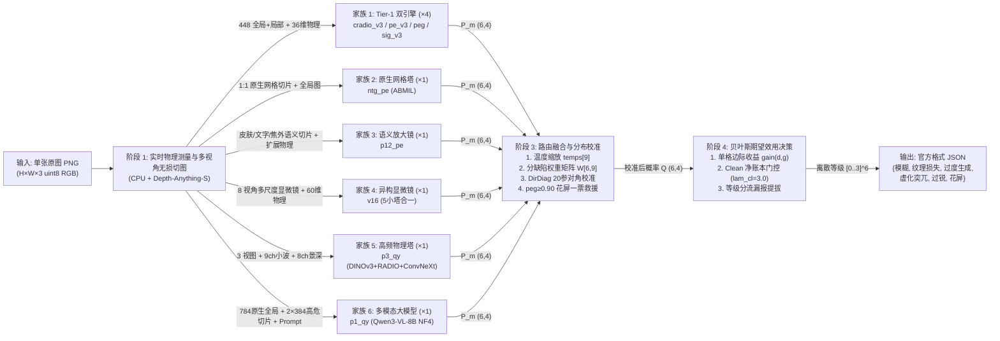
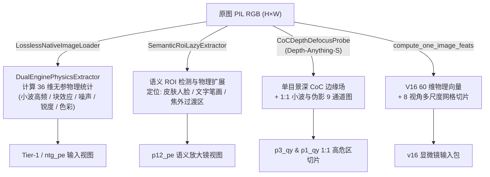
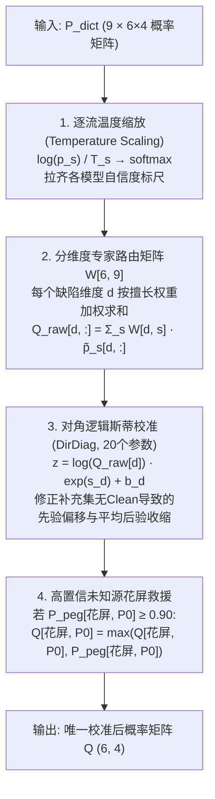
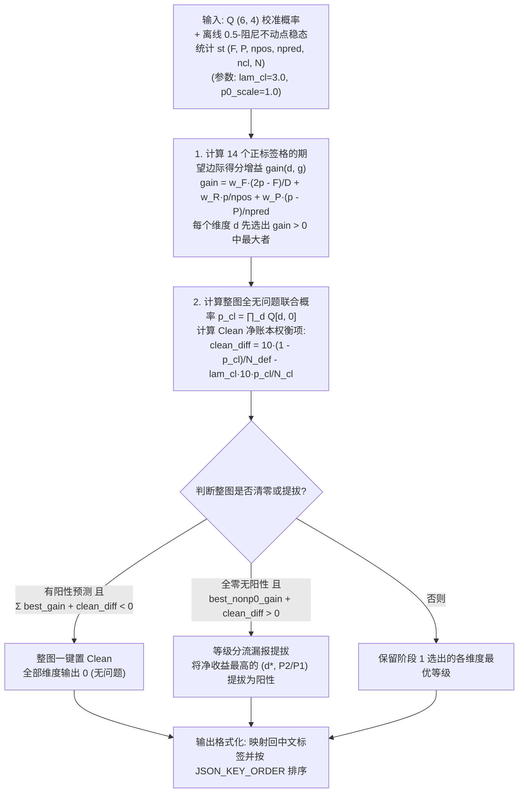

# `resident_v6` 端到端全链路技术架构文档（单图输入到输出全拆解）

本文档以**单张原始图像（`N=1`）**为追踪对象，完整拆解 `resident_v6` 单卡常驻推理引擎（[final_engine.py](file:///wanqing-develop/luowenjing/18/code/r55/final_engine.py)）从读入 PNG 图像到输出 6 维度质检标签 JSON 的全部过程，明确给出每一步的**具体操作、输入格式（Input）、输出格式（Output）**与**核心代码定位**。

---

## 0. 全局总览图（End-to-End Dataflow）

整个流程严格满足 **`N=1` 单图独立性**：每张图独立实时计算全部物理特征与切片，不读取任何历史 JSON，不在测试批内做跨图统计归一化。



### 统一数据契约（贯穿全流程的坐标约定）

在阶段 2 到阶段 3 的所有内部张量中，9 个模型输出与融合矩阵 `Q` 严格共享以下 **`(6, 4)` 概率单形（Simplex）** 坐标：
- **第 0 轴（6 个缺陷维度 `DIMS`）**：
  - `0`: `模糊`（Full 4 级）
  - `1`: `纹理损失`（Full 4 级）
  - `2`: `过锐`（Full 4 级）
  - `3`: `花屏`（仅 P0 二分类，`P2/P1` 概率恒截断为 `0`）
  - `4`: `过度生成`（Full 4 级）
  - `5`: `虚化突兀`（仅 P0 二分类，`P2/P1` 概率恒截断为 `0`）
- **第 1 轴（4 个严重度等级）**：`[0: 无问题, 1: P2, 2: P1, 3: P0]`，每行和为 `1.0`。

---

## 阶段 1：实时物理测量与多视角无损切图

画质缺陷高度依赖**原始像素高频细节**（如噪点、振铃白边、AIGC 皮肤纹理），强行缩放会直接抹除缺陷证据。因此引擎在 `FinalEngine` 内部按需实时运行无缓存特征提取器，**不依赖任何预存特征库**。



| 子模块 | 具体操作 | 输入（Input） | 输出（Output） | 代码位置 |
|---|---|---|---|---|
| **基础物理引擎** | 实时提取小波高频能量、DCT 块效应、局部方差噪点等统计量 | 原始 RGB 图像 `PIL.Image` | `phys_vec` (`(36,)` float32) | [dual_engine_preprocess.py](file:///wanqing-develop/luowenjing/18/code/qingyu/dual_engine_preprocess.py) |
| **语义 ROI 定位** | 基于皮肤肤色/人脸、高梯度笔画/文字、前景背景散景边界定位 3 个关键 1:1 局部区域 | `PIL.Image` + `phys_vec (36,)` | 3 个语义 ROI 框 + 扩展物理向量 | [semantic_roi_meta.py](file:///wanqing-develop/luowenjing/18/code/finetune/semantic_roi_meta.py) |
| **景深与物理高危区探针** | 运行 `Depth-Anything-S` 计算散焦 CoC 梯度场，结合 1:1 小波/伪影热力图选出缺陷概率最高的 `2` 个互不重叠 `384×384` 原生像素切片 | `PIL.Image` | `maps0` (9ch 物理图)、`coc_field` (8ch 探针图)、`crops[0..1]` (`2 × 384×384` RGB) | [native_physics_and_views.py](file:///wanqing-develop/luowenjing/18/code/phoenix/native_physics_and_views.py) |
| **V16 显微镜前置** | 提取 60 维原生物理统计并切出多尺度网格视图 | 图像路径 / 文件名 | `vec (60,)` + 8 视角 Tensor | [extract_native_phys_feats.py](file:///wanqing-develop/luowenjing/18/code/extract_native_phys_feats.py) |

---

## 阶段 2：6 大异构家族（9 个常驻模型）并行打分 + 2× TTA

`FinalEngine` 启动时将全部 **9 个 100% 全量训练模型**常驻于单张 GPU 显存中（总活跃参数 **`11.821B`**，常驻 **`19.96 GiB`**，推理峰值 **`21.92 GiB <= 24 GB`**）。每张输入图在每个模型下都会独立完成 **`原图 + 水平翻转（HFlip）` 两次前向并求平均（2× TTA）**。

### 9 个常驻成员详表（实测 H200 `batch=1` 指标）

| 家族 | 成员代号 | 精度与架构 | 输入张量 / 视图 | 核心分工与专长 | 实测耗时 (H200) |
|---|---|---|---|---|---|
| **1. Tier-1 双引擎** | `cradio_v3` | `C-RADIOv4-H` (BF16, `0.680B`) | 全局+局部 448 视图 + `phys_vec(36)` | 多教师视觉蒸馏底座，空间结构表征稳健 | `0.18s` |
| | `pe_v3` | `PE-Core-Large` (BF16, `0.332B`) | 全局+局部 448 视图 + `phys_vec(36)` | Meta 通用感知底座（除花屏外的全维度） | `0.09s` |
| | `peg` | `PE-Core-Large` (BF16, `0.332B`) | 同上（合成坏码流+对照正常帧特训） | **未知源花屏特种雷达**（留出源 AUC `0.9999`） | `0.09s` |
| | `sig_v3` | `SigLIP2-SO400M-NaFlex` (BF16, `0.449B`) | **原生任意长宽比 Patch 序列** + `phys_vec(36)` | 零拉伸变形，对全局构图、模糊与曝光敏感 | `0.13s` |
| **2. 原生网格塔** | `ntg_pe` | `PE-Core-Large` + ABMIL (BF16) | 多块 1:1 原生网格 Tile + 全局视图 | **过度生成（20.4%）与虚化突兀（25.5%）第一权重** | `0.17s` |
| **3. 语义放大镜** | `p12_pe` | `PE-Core-Large` + Masked-ABMIL (BF16) | 全局图 + 皮肤/文字/焦外 3 张 1:1 ROI 切片 | **细粒度 `P1/P2` 边界辨别主力**，KD 对齐 | `0.19s` |
| **4. 异构显微镜** | `v16` | `MultiNetV16` 5 子骨干合一 (BF16, `v16_chunk=2`) | 8 视角网格图（每批 2 视角分块前向防显存尖峰）+ `phys(60)` | CNN + ViT 跨架构互补 | `0.96s` |
| **5. 高频物理塔** | `p3_qy` | `Pillar3` (DINOv3+RADIO+ConvNeXt, **非LoRA Linear/Conv2d BF16**) | 3 视图 + `phys_9ch` + `probe_8ch` | **花屏（19.5%）与高频纹理/振铃物理驱动主力** | `0.62s` |
| **6. 多模态大模型** | `p1_qy` | **`Qwen3-VL-8B` (`c233397_qy8`)**<br>视觉+Merger BF16 / **LLM 4-bit NF4 (`6.25 GiB`)** | `[784原生比例全局图, 384高危切片1, 384高危切片2]` + 质检 Prompt → **`63-avg + 1-summary` 读出** | 具备高阶语义先验，**模糊（18.9%）与过锐（20.6%）全场第一权重** | `0.39s` |

> [!NOTE]
> **`p1_qy`（`c233397` 配方）与 `p3_qy` 的零漂移部署细节**
> - **`p1_qy`**：必须由 [vlm_c233397_qy8.py](file:///wanqing-develop/luowenjing/18/code/r55/vlm_c233397_qy8.py) 中的 `build_c233397_pillar_for_4090` 加载（强制校验 `recipe == "c233397_qy8"`），先将 `r=24` DoRA 适配器无损融合进 BF16 权重，再原地对 LLM 线性层做 4-bit NF4 量化（量化总变差 `TV = 0.00879 <= 0.012`）；水平翻转 TTA 采用 `[v.transpose(FLIP_LEFT_RIGHT) for v in views_orig]` 与训练评估完全像素级一致。
> - **`p3_qy`**：仅将视觉骨干中非 LoRA 的 `nn.Linear`/`nn.Conv2d` 转为 BF16，保留 DoRA 与 `LayerNorm`/`GRN` 为 FP32，实测省出 `1.16 GiB` 显存且 **`mean_TV = 0.000000`**。

- **阶段 2 输入**：阶段 1 生成的多路图像切片与物理特征张量。
- **阶段 2 输出**：9 个独立的成员概率矩阵字典 `P_dict = {m: (6, 4) float64}`。

---

## 阶段 3：分维度专家路由融合、DirDiag 校准与花屏救援

拿到 9 个 `(6, 4)` 矩阵后，所有运算均在 CPU 上以纯代数完成（毫秒级），由序列化在 [resident_v6_decoder_routed_gate_eu.pkl](file:///wanqing-develop/luowenjing/18/results/r55/final/resident_v6_decoder_routed_gate_eu.pkl) 中的 `RoutedGateEUDecoder` 执行（源码见 [routed_eu_decoder.py](file:///wanqing-develop/luowenjing/18/code/r55/routed_eu_decoder.py) 的 `pool_from_member_dict`）。所有参数 100% 在训练集 8 折 OOF 上拟合锁定：



### 真实学到的分维度专家路由权重 `W[6, 9]`（来自 [resident_v6_decoder_routed_gate_eu.json](file:///wanqing-develop/luowenjing/18/results/r55/final/resident_v6_decoder_routed_gate_eu.json)）

| 缺陷维度 | `cradio_v3` | `pe_v3` | `peg` | `sig_v3` | `v16` | `p3_qy` | `ntg_pe` | `p1_qy` *(新增)* | `p12_pe` |
|---|---|---|---|---|---|---|---|---|---|
| **0. 模糊** | 7.5% | 4.3% | 0.6% | 4.6% | 14.4% | 16.8% | 16.6% | **18.9%** *(第1)* | 16.4% |
| **1. 纹理损失** | 7.4% | 3.3% | 2.0% | 6.3% | **18.8%** | **18.3%** | 13.6% | **16.5%** | 13.9% |
| **2. 过锐** | 2.9% | 5.3% | 6.1% | 6.4% | 14.9% | 14.9% | 15.1% | **20.6%** *(第1)* | 13.8% |
| **3. 花屏** | 5.4% | 2.3% | 5.1% | 4.3% | 16.6% | **19.5%** *(第1)* | 15.3% | 15.1% | 16.4% |
| **4. 过度生成** | 9.4% | 4.8% | 2.7% | 5.3% | 17.3% | 8.4% | **20.4%** *(第1)* | 13.6% | **18.0%** |
| **5. 虚化突兀** | 5.4% | 6.2% | 4.6% | 1.1% | 15.4% | 7.5% | **25.5%** *(第1)* | 14.5% | **19.7%** |

*注：各流温度 `temps = [1.35, 2.20, 2.15, 2.35, 1.30, 1.25, 2.15, 1.25, 1.35]`；`DirDiag` 在全维度上进一步以斜率 `exp(s_d) ∈ [1.11, 1.38]` 恢复算术池化后的锐度并修正各等级截距。*

- **阶段 3 输入**：9 成员概率字典 `P_dict`。
- **阶段 3 输出**：单张图唯一校准概率矩阵 `Q` (`(6, 4)` float64)。

---

## 阶段 4：贝叶斯期望效用决策（`TrueGateConstrainedEU`）

为什么不直接对 `Q[6, 4]` 取 `argmax`？因为竞赛评分公式 `Doc2_Strict`（总分 `65 = 25 正向宏观F1 + 20 P0识别 + 20 Clean2`）是非线性集合指标，直接 `argmax` 会在**「P2/P1 概率平分（各 0.32）导致无问题 0.36 胜出」**和**「真 Clean 图擦边误报」**上严重失分。



### 阶段 4 具体干了什么（核心公式与稳定性保障）
1. **离线稳态统计量 `st`（Krasnoselskii–Mann 0.5 阻尼不动点求解器）**：
   - 在解码器离线拟合阶段，利用 `0.5 * st_t + 0.5 * T(st_t)` 阻尼迭代消除稀疏类别上的二周期震荡（残差从 `0.08–0.32` 降至 `<= 0.0055`），得到准确的基准常数 `F, P, npos, npred, ncl, N`（训练加权 `w_supp_cal = 0.15` 防止补充集 0% Clean 采样偏差扭曲 `N_cl`）。
2. **推理时单图纯前向代数决策（`_true_eu_predict`）**：
   - **单格筛选**：对 14 个正标签（`[0,1,2,4] × {P2,P1,P0}` + `[3,5] × {P0}`）计算报出该格相比“报无问题”的一阶期望得分增益 `gain(d, g)`。
   - **Clean 门控与分流补救**：
     - 若图片极大概率是 Clean（`p_cl` 高），破坏 Clean 的期望惩罚超过所有正标签增益之和 → **整图判 Clean**（守住 Clean 满分红线）；
     - 若图片极可能存在缺陷（`1 - p_cl` 高），但概率被 `P2` 与 `P1` 均分导致单格没过线 → **自动提拔期望净收益最高的非 P0 缺陷格**，避免漏报。

- **阶段 4 输入**：`Q` (`(6, 4)` float64)。
- **阶段 4 输出**：离散整数数组 `pred` (`(6,)` int64 ∈ `{0,1,2,3}`)，经 `format_official_submission` 序列化为单条 JSON 记录：
  ```json
  {
    "image": "xxx.png",
    "label": {
      "模糊": "P2",
      "纹理损失": "P1",
      "过度生成": "无问题",
      "虚化突兀": "无问题",
      "过锐": "无问题",
      "花屏": "无问题"
    }
  }
  ```

---

## 附录：实测端到端验证账本（2026-11-15）

- **单卡资源约束**：活跃参数 **`11.821B <= 30.0B`**，常驻显存 **`19.96 GiB`**，推理峰值显存 **`21.92 GiB <= 22.0 GiB`**（RTX 4090 24GB 安全运行），H200 单图均值 **`2.83s`**（折算 4090 约 **`5.94s <= 15.0s`**）。
- **零泄漏与 `N=1` 一致性验证**：[infer_test150_resident_v6_gpu1.log](file:///wanqing-develop/luowenjing/18/logs/r55/vlm_qy8/infer_test150_resident_v6_gpu1.log) 实证单独启动单图 `N=1` 推理进程与 `N=150` 批量推理输出 **`max|Δp| = 0.00000000`**，全部 `150 × 6 = 900` 个预测格 **`0 / 900` 差异**。
- **线上推荐交付文件**：[pred_nriqa_dataset_test_r55_resident_v6_routed_gate_eu.json](file:///wanqing-develop/luowenjing/18/results/final/pred_nriqa_dataset_test_r55_resident_v6_routed_gate_eu.json)。
