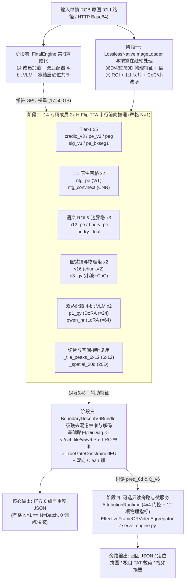
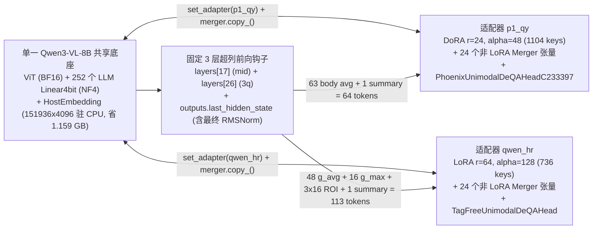
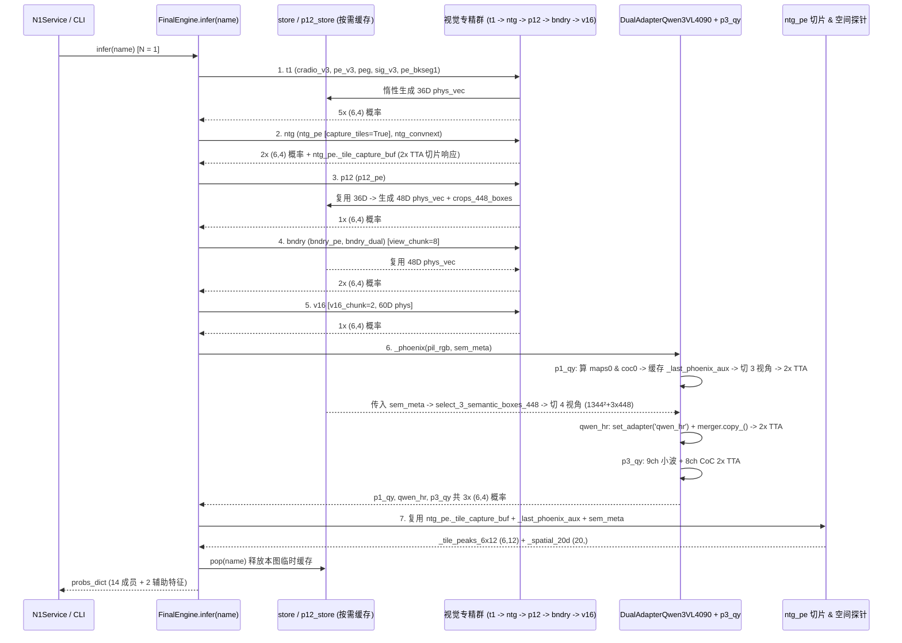
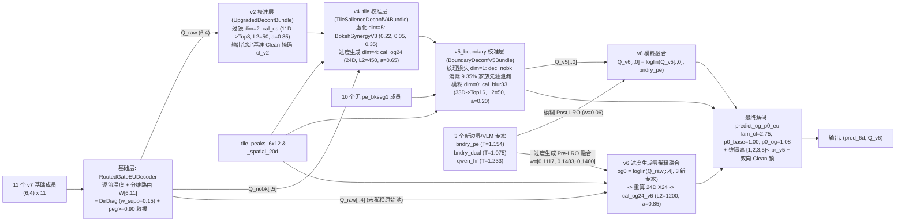

# 晴羽观感体系无参画质 BadCase 检测系统端到端技术汇报

> **文档范围**：以最终交付主线架构 **`resident_v8_boundary` + `deconf_v6_boundary`** 为对象，按单张图像（`N = 1`）从输入到输出的实际执行路径，系统说明初始化、在线预处理、多尺度专精推理、级联去混淆校准、贝叶斯期望效用解码及可选旁路（归因、视频聚合、HTTP 服务）的处理逻辑、实现方式与设计依据。  
> **基准核查日期**：`2026-11-20`（基于工作区实际源码与 2026-11-20 最新空卡实测审计 JSON 核对；仓库当前处于含未提交变更的工作区状态，所有结论以本文件标明的源码路径与实测产物为准）。

---

## 一、系统定位、任务目标与整体框架

### 1.1 任务目标与硬约束

本系统针对短视频无参考画质质检场景，对单帧 RGB 图像输出 **6 类画质缺陷** 的离散严重度等级（共 **14 个正向“缺陷 × 等级”子通道**）：

- **四级有序维度（`FULL_DIMS = (0, 1, 2, 4)`）**：`模糊`、`纹理损失`、`过锐`、`过度生成`，取值集合 `{"无问题", "P2", "P1", "P0"}`（内部整型 `0, 1, 2, 3`）。
- **二级高风险维度（`P0_ONLY_DIMS = (3, 5)`）**：`花屏`、`虚化突兀`，取值集合 `{"无问题", "P0"}`（内部整型 `0, 3`）。

系统必须同时满足五项工程与评测硬约束（已固化于 [`AGENTS.md`](file:///wanqing-develop/luowenjing/18/AGENTS.md) 与官方规则）：

1. **客观评分指标（`Doc2_Strict`，满分 65 分）**：由正向缺陷 `25·S_pos`（14 通道宏平均 F1，准入 `>= 15`）、高风险 `20·S_p0`（6 维 P0 F1/召回/精确率复合项，准入 `>= 13`）与全无问题控制 `20·S_clean`（Clean 整图一票否决项，准入 `>= 12`）组成，总分准入 `> 40`。
2. **单卡资源与性能上限**：目标部署规格为单张 24 GB GPU（RTX 4090 预算），激活参数 `<= 30B`，设备级显存峰值 `< 24 GiB`，单图端到端延迟 `<= 15s`，零外部付费 API，完全断网可运行。
3. **逐图独立性（`N = 1 == N = Batch`）**：单图流式推理结果必须与整批推理结果逐格完全一致，禁止跨图统计归一化或测试集先验重校准。
4. **零泄漏与零历史锚定**：严禁读取任何历史版本推理 JSON 做覆写，严禁向模型输入文件名/批次标签（100% Tag-Free），所有校准与阈值仅在 8-Fold 视频分组嵌套 OOF（`N = 3,573`）上拟合，推理期零训练数据文件读取。
5. **旁路零侵入**：语义归因、极目/TAT 载荷导出与多帧视频聚合均作为严格只读旁路运行，不得修改单图主预测标签。

### 1.2 输入输出契约与内部数据结构

#### 输入接口

| 调用模式 | 入口文件 | 输入格式 | 隔离与预处理要求 |
| :--- | :--- | :--- | :--- |
| 离线批量 CLI | [`run_final_infer.sh`](file:///wanqing-develop/luowenjing/18/run_final_infer.sh) -> [`code/r55/final_engine.py`](file:///wanqing-develop/luowenjing/18/code/r55/final_engine.py) | 模板 JSON（含 `[{"image": "<name>", ...}]`）+ 本地图片目录 `--img-dir` | 仅读取模板 ID 顺序；通过 `LosslessNativeImageLoader` 加载原生 RGB 图像，不读取任何历史预测或特征缓存 |
| 在线单图 HTTP | [`code/r55/serve_engine.py`](file:///wanqing-develop/luowenjing/18/code/r55/serve_engine.py) (`POST /infer`) | `{"image_path": "..."}` 或 `{"image_base64": "...", "image_name": "..."}` | 经 `Service._stage()` 生成唯一前缀 `srv_<uuid12>_<orig>` 软链/暂存至 `--spool-dir`，防止同名文件冲突，请求结束后立即删除 |
| 批量/视频 HTTP | [`code/r55/serve_engine.py`](file:///wanqing-develop/luowenjing/18/code/r55/serve_engine.py) (`POST /infer_batch`) | `{"image_paths": [...], "video_id": optional}`（上限 `--max-batch 256`） | 逐帧复用 `N1Service.predict()`，再按 `video_id` 或 `infer_video_group_id()` 聚合输出视频级结论 |

#### 内部核心数据契约

- **规范概率张量**：每个模型成员对单张图像输出形状为 `(6, 4)`、`float32/float64`、行和为 `1.0` 的概率单纯形。第 0 轴固定为内部维度序 `DIMS = ["模糊", "纹理损失", "过锐", "花屏", "过度生成", "虚化突兀"]`；第 1 轴固定为 `[无问题(0), P2(1), P1(2), P0(3)]`（二分类维 `3, 5` 的索引 `1, 2` 概率为 `0` 或极小值 `1e-6`）。
- **推理中间字典 `probs`**：`FinalEngine.infer(name)` 返回 `Dict[str, np.ndarray]`，包含 14 个成员的 `(6, 4)` 概率数组，以及两个零额外模型生成的辅助特征键：`_tile_peaks_6x12`（`(6, 12)` `float32`）和 `_spatial_20d`（`(20,)` `float32`）。

#### 输出格式

- **主预测 JSON**：经 `common55.format_official_submission()` 将内部 `DIMS` 映射为赛题规定键序 `["模糊", "纹理损失", "过度生成", "虚化突兀", "过锐", "花屏"]`，并通过 [`code/r55/validate_submission.py`](file:///wanqing-develop/luowenjing/18/code/r55/validate_submission.py) 校验样本数、唯一 ID 集合对齐与合法标签取值。
- **可选旁路产物**（`--emit-attribution` / `--tat-out` / `--video-mode`）：单图实测物理归因 JSON、可视化定位拼图 `_sheet.jpg`、极目/TAT 标准载荷 JSON、多帧视频级摘要 JSON。

### 1.3 核心模块与端到端总体架构

系统分为 **初始化与资源管理层**、**在线预处理层**、**14 成员多尺度推理层**、**级联校准与期望效用解码层** 和 **可选旁路与服务化层** 五个层次：

### 1.4 证据来源口径与事实边界声明

为保证全文严谨可核查，下文所有陈述均严格区分三类证据状态：

| 证据类别 | 范围与依据 |
| :--- | :--- |
| **已确认事实（代码与实测）** | 所有类/函数/张量维度/配置常量均核对自当前工作区源码；8-Fold OOF、显存、耗时、归因一致率与 HTTP 审计均来自 `results/r55/final/` 下实测 JSON；`test_150` 线上得分 `54.77 / 65`（`Pos 17.46 / P0 17.31 / Clean 20.00`）来自平台提交回执 |
| **工程推断** | 例如基于 `sm_80/sm_86` SASS 二进制兼容与 H200 上 NVML 峰值 `21.02 GiB < 23.99 GiB` 推断可在 RTX 4090 上不 OOM 运行 |
| **待验证项与已知限制** | 明确集中列于第八节，包含真实 RTX 4090 真机耗时/显存复测、视频审计脚本 `M=1` 合成对照口径微差、分布外高分辨图像覆盖边界等 |

---

## 二、阶段零：引擎初始化与单卡 24GB 显存预算控制

### 2.1 输入、处理逻辑与加载顺序

- **入口**：`FinalEngine.__init__(members, device="cuda", img_dir="", half=True, v16_chunk=2, share_weights=True, embed_on_host=True)`（[`code/r55/final_engine.py`](file:///wanqing-develop/luowenjing/18/code/r55/final_engine.py)）。
- **输入**：成员列表 `SETS["resident_v8_boundary"]`（14 个成员名）、本地开源基座路径（`models/` 或 `R55_BASE_MODELS_DIR`）以及 14 个 Full-Fit 微调检查点。
- **操作顺序（关键显存峰值控制）**：引擎按严格顺序加载并实时触发 `note(tag)`（依次执行 `_share_identical_weights()` -> `torch.cuda.synchronize()` -> `gc.collect()` -> `torch.cuda.empty_cache()`）：
  1. **最先加载 `CoCDepthDefocusProbe` 与 `DualAdapterQwen3VL4090`（`p1_qy + qwen_hr`）**：因为 `Qwen3-VL-8B` 加载原始 BF16 权重再原地量化至 4-bit NF4 时，存在约 `~16 GB` 瞬态显存峰；将其置于空卡首位加载并立刻量化卸载词表，使瞬态峰不与后续视觉模型叠加（实测全过程加载峰值 `nvidia-smi = 20,714 MiB = 20.23 GiB`）。
  2. **随后依次加载 `p3_qy` -> Tier-1 (`cradio_v3`, `pe_v3`, `peg`, `sig_v3`, `pe_bkseg1`) -> NTG (`ntg_pe`, `ntg_convnext`) -> `p12_pe` -> Stage 2B 边界塔 (`bndry_pe`, `bndry_dual`) -> `v16`**。
  3. **精度策略（`--half`）**：各视觉塔骨干在 CPU 上先转 `bf16` 再搬运到 GPU（GPU 从未持有其 FP32 副本），但所有读出层（`tap3`, `dual_tap`, `abmil`, `masked_abmil`, `spatial_proj`）及分类头强制保留 `fp32` 并在前向中关闭 autocast，防止门控 softmax / 归一化在低精度下溢或漂移。

### 2.2 核心显存压缩机制与实现细节

#### 机制 A：单 4-bit 底座双适配器共享 VLM（`DualAdapterQwen3VL4090`）

实现位于 [`code/r55/dual_vlm_shared_4090.py`](file:///wanqing-develop/luowenjing/18/code/r55/dual_vlm_shared_4090.py)（设计决策见 [`ADR-002`](file:///wanqing-develop/luowenjing/18/docs/decisions/ADR-002-dual-adapter-vlm-and-weight-sharing.md)）：

- **实现要点**：
  - 加载 `Qwen3VLForConditionalGeneration` 后仅保留 `full.model`（丢弃 `lm_head`）并调用 `quantize_llm_inplace()` 将 LLM 252 个线性层原地转为 `bitsandbytes` 4-bit NF4（`compute_dtype=bfloat16`）。
  - 通过 `peft` 在同一底座上挂载两套命名适配器 `"p1_qy"` 与 `"qwen_hr"`，靶向 11 类投影层（`q/k/v/o/gate/up/down_proj`, `qkv`, `proj`, `linear_fc1`, `linear_fc2`），并将两套检查点中非 LoRA 的 24 个视觉 merger 权重（`~20 MB`）各自缓存于 `self._nonlora_p1` / `self._nonlora_qh`。
  - `_activate(adapter)` 切换 `set_adapter(adapter)` 并在需要时原地 `.copy_()` 对应 24 个 merger 张量（切换开销 `< 1 ms`）。
  - 两套适配器合计常驻仅 **`5.67 GB`**（含 Depth-Anything 探针；独立测试双 VLM 净常驻 `5.62 GB`，较独立部署两份 4-bit 8B VLM 节省 **`~3.40 GB`**）。
- **设计取舍**：独立版 `p1_qy` 是先合并 DoRA 再 4-bit 量化（`NF4(W + DoRA)`），而共享底座版为保持底座可切换，执行 `NF4(W) + bf16(DoRA)`。独立对比测试确认两者 `mean|Δp| = 0.00220`（`test_150` 全量实测 `0.001911`）、`qwen_hr` `mean|Δp| = 0.00150`，`argmax` 一致率均为 `100.0%`。

#### 机制 B：VLM 词表主机内存卸载（`_move_token_embedding_to_host`）

- `Qwen3-VL-8B` 词表矩阵 `language_model.embed_tokens` 形状为 `(151936, 4096)`（BF16 占 **`1.159 GB`**），但系统使用固定质检系统 Prompt，99.9% 词表行永不访问。
- 实现将 `embed_tokens` 替换为自定义 `HostEmbedding` 模块，把权重以普通属性 `self.table`（非 `nn.Parameter`，防止 `.to(device)` 误搬回 GPU）保存在 CPU 内存中；前向时执行 `F.embedding(input_ids.to("cpu"), self.table).to(input_ids.device)`，仅将当前 Prompt 数百个 token 向量传入 GPU，数值严格零误差。

#### 机制 C：冻结层逐位存储共享（`_share_identical_weights`）

- 在 14 个成员中，7 个塔共享 `PE-Core-Large` 底层冻结块（`pe_v3`, `peg`, `pe_bkseg1`, `ntg_pe`, `p12_pe`, `bndry_pe`, `bndry_dual`），4 个塔共享 `C-RADIOv4-H` 底层冻结块（`cradio_v3`, `bndry_dual`, `p3_qy`, `v16`），另有 `ConvNeXtV2-Base`、`DINOv3-ViT-L/16` 冻结块复用。
- `_share_identical_weights(min_bytes=65536)` 遍历所有驻留模块的参数与缓冲区（跳过 `uint8` 打包的 4-bit 权重和小于 64 KiB 的小张量），以 `(dtype, shape, 257 点均匀采样字节签名)` 分桶，再执行 **精确逐元素 `torch.equal()` 校验**；确认完全一致后通过 `t.data = canon` 指向首个规范张量的底层显存存储，并由 `torch.cuda.empty_cache()` 立即回收冗余副本。
- **实测结果**（[`resident_v8_boundary_bench_half.json`](file:///wanqing-develop/luowenjing/18/results/r55/final/resident_v8_boundary_bench_half.json)）：共无损释放 **`5.808 GB`** 显存。新增 `bndry_pe` 仅增加 `+0.28 GB`，新增双干 `bndry_dual` 仅增加 `+0.63 GB`。

#### 机制 D：纯 PyTorch `INT8-g128` 量化未共享大骨干、分块前向与参数量统计口径说明

- **纯 PyTorch 对称 `INT8 group-128` 权重量化（`_quantize_linear_int8_g128`）**：在 `v16` 的 5 个子骨干中，`PE-Core-G14`（1.88B 参数、3.76 GB BF16）与其他 13 个成员完全不共享。`FinalEngine.__init__` 在 `half=True` 时于 CPU 上对其 205 个大矩阵线性层执行零外部依赖的对称 `INT8 group-128` 权重量化（100% BF16 激活、保留 FP32 头部），在上传 GPU 前直接减少 **`1.72 GiB`** 常驻显存，且经全量 `test_150` 复测确认与纯 BF16 权重严格 **`0 / 900` 格差异**。
- **激活尖峰削峰与无损加速**：`v16` 采用 `v16_chunk=4`，`ntg_convnext` 采用 `tile_chunk=4`、`ntg_pe` 采用 `tile_chunk=8`，`cradio_v3` 采用 `infer_global_chunk=1 / infer_view_chunk=4`，`BoundaryTileTower` 采用 `view_chunk=8`（全部 100% 比特精确）；叠加 Tier-1 `PE-Core-Large` 冻结前缀共享前向计算、`B=2` H-Flip TTA 批处理与双线程 CPU 预取，并默认开启 `PYTORCH_CUDA_ALLOC_CONF=expandable_segments:True`。
- **参数量统计口径（严谨声明）**：`FinalEngine.__init__` 报告的 `total_params_b = 13.262B` 按 `id(prm)` 去重累加 `prm.numel()`（并完整计入 `_WeightOnlyINT8GroupLinear` 量化前的原始参数量）。需明确两项口径细节：① `--share-weights` 通过 `t.data = canon` 共享物理存储但仍保留各自的 Python `nn.Parameter` 包装对象，因此共享后的视觉冻结层元素在 `13.262B` 中仍按成员计入；② `Linear4bit` 的 `Params4bit` 以打包 `uint8` 计 `numel()`（约为原始参数量一半）。该数值反映加载后的显存/计算实体口径，远低于 `30B` 红线。

### 2.3 逐成员加载显存增长与输出状态

下表为 [`resident_v8_boundary_bench_half.json`](file:///wanqing-develop/luowenjing/18/results/r55/final/resident_v8_boundary_bench_half.json) 2026-11-20 空卡实测记录（H200 GPU 0，开启 `--half --share-weights --embed-on-host`）：

| 加载阶段 | 常驻显存累计 (GB) | 本步净增量 (GB) | 共享/压缩机制说明 |
| :--- | :---: | :---: | :--- |
| `dual_vlm` (`p1_qy + qwen_hr` + CoC) | `5.67` | `+5.67` | 单 4-bit NF4 底座 + 双适配器 + `1.159 GB` 词表驻 Host |
| `p3_qy` | `8.34` | `+2.67` | 4 骨干超列 BF16（确立 `DINOv3`/`C-RADIO`/`PE`/`ConvNeXt` 规范块） |
| `cradio_v3` | `8.90` | `+0.56` | 与 `p3_qy` 共享 `C-RADIOv4-H` 冻结块 |
| `pe_v3` / `peg` / `pe_bkseg1` / `ntg_pe` / `p12_pe` | `9.17 -> 11.30` | 各 `+0.26~0.27` | 5 塔仅保留各自解冻顶层 + 头部（底层与 `p3_qy` 共享） |
| `sig_v3` | `10.31` | `+0.87` | 独立 `SigLIP2-SO400M-NaFlex` 塔 |
| `ntg_convnext` | `11.04` | `+0.19` | 与 `p3_qy` 共享 `ConvNeXtV2-Base` 冻结阶段 |
| `bndry_pe` | `11.58` | **`+0.28`** | 共享 `PE-Core-Large` 底层，仅增顶层 9 块 + `PerDefectRoutedTileHead` |
| `bndry_dual` | `12.21` | **`+0.63`** | 同步共享 `PE-Core-Large` 与 `C-RADIOv4-H` 双冻结底层 |
| `v16` (`pecoreg INT8-g128`) | **`15.78`** | **`+3.57`** | 独有 `PE-Core-G14` 经 `INT8-g128` 省 `1.72 GiB`，其余子骨干共享冻结块 |

- **阶段输出**：全部 14 个模型常驻就绪的 `FinalEngine` 实例（`resident = 15.78 GB`，`peak_load = 18.75 GB`，NVML `peak_load = 19.98 GiB`，推理峰值 `18.49 GiB`），以及按需懒加载的 `self.store` / `self.p12_store` 空元信息字典，直接传递给阶段一。

---

## 三、阶段一：单图输入加载与按需在线预处理

### 3.1 输入与处理逻辑

- **输入**：单张图像标识 `name`（对应磁盘原生无损图片文件，HTTP 模式下为 `_stage()` 创建的带 UUID 前缀的临时文件路径）。
- **处理逻辑**：为严守“无特征缓存、零训练读取、内存零泄漏”要求，引擎不在启动时预载任何 `.npz` 特征库，而是在 `FinalEngine.infer(name)` 内部按首次需要延迟计算四路互补物理特征与多视角切图，并在当前图像全部成员共享复用后立即清除：

| 预处理子模块 | 触发时机与代码位置 | 核心计算操作 | 输出数据结构 | 下游消费方 |
| :--- | :--- | :--- | :--- | :--- |
| **1. 基础双引擎物理探针** | 首个 Tier-1 成员调用时触发 `self.store` (`DualEnginePhysicsExtractor`) | 计算原生帧小波高频比、8×8 DCT 块效应、平坦区方差、色彩剪裁率等基础物理量 | `store.map[name]["phys_vec"]` (`(36,)` `float32`) + 高危 ROI 框 | `cradio_v3`, `pe_v3`, `peg`, `sig_v3`, `pe_bkseg1`, `ntg_pe`, `ntg_convnext`, 阶段二空间探针 |
| **2. 语义 ROI 扩展探针** | `_p12` 或 `_bndry` 首次调用 `analyze_semantic_rois_pil()` | 复用 36-D `base_phys_36`，追加皮肤占比、字幕/文字笔画梯度、人脸/手部/散景交界 4 个 1:1 `448×448` 框 | `p12_store.map[name]`：48-D `phys_vec` + `crops_448_boxes (4, 4)` | `p12_pe`, `bndry_pe`, `bndry_dual`, `qwen_hr` (`select_3_semantic_boxes_448`), `_spatial_20d` |
| **3. 1:1 动态切片与翻转不变能量** | `_bndry` 调用 `extract_native_tiles_coords_energy()` | 反射填充至 `>= 448`，按 `tile_starts` 均匀平铺切 `448×448` 原生块（超出 `tile_cap=12` 时确定性筛选）；计算翻转不变空间坐标 `(y_c, 2*|x_c-0.5|, h_f, w_f)` 与下采样 4× 梯度+拉普拉斯高频能量 `e_t` | `global_u8 (448,448,3)`, `tiles_u8 (T,448,448,3)`, `coords (T,4)`, `energies (T,)` | `bndry_pe`, `bndry_dual`（2× H-Flip 分别提取） |
| **4. 光学散焦 CoC 与双极小波场** | `_phoenix` 调用 `compute_1to1_wavelet_and_artifact_maps()` 与 `self.coc` (`Depth-Anything-V2-Small`)；`_v16` 调用 `compute_one_image_feats()` | 计算半分辨率双极光晕图、UI/字幕掩码、高频能量与 `z_hat` 景深雅可比场；选出 2×`384×384` 高危块与 V16 60-D 物理特征 | `maps0` 字典、`coc0` 场、V16 `vec (60,)` | `p1_qy`, `p3_qy`, `v16`, `_spatial_20d`（通过 `self._last_phoenix_aux` 零重复计算复用！） |

### 3.2 设计依据与生命周期管理

- **零重复计算设计**：例如 `p12_store.map[name]` 在 `p12_pe` 运行时生成，随后直接被 `bndry_pe`、`bndry_dual`、`qwen_hr` 和 `_spatial_20d` 连续复用 4 次；`p1_qy` 计算的 `maps0` 和 `coc0[:, :, 0]`（深度图）缓存在 `self._last_phoenix_aux`，供末尾 `_spatial_20d` 复用，避免重复跑一次 `Depth-Anything-V2-Small`。
- **防止常驻服务内存增长**：`FinalEngine.infer(name)` 返回前强制执行 `self.store.map.pop(str(name), None)` 与 `self.p12_store.map.pop(str(name), None)` 并清空 `self._last_phoenix_aux = None`，保证长运行 HTTP 服务 Host RAM 恒定不泄漏。
- **翻转不变性细节**：`extract_native_tiles_coords_energy` 刻意将水平坐标编码为对称距离中心值 `2*|x_c - 0.5|`，且高频能量 `e_t` 为左右对称一阶/二阶差分绝对值均值，保证 H-Flip 增强与 2× TTA 下几何与能量分布严格同分布。

---

## 四、阶段二：14 专精成员多尺度前向推理与零冗余特征复用

### 4.1 单图推理执行时序与特征复用链路

`FinalEngine.infer(name)` 在 `torch.no_grad()` 上下文中按固定串行顺序执行所有 14 个成员及 2 个探针（每个成员均执行原图 + 水平翻转 `2× H-Flip TTA` 并对概率取算术平均），确保任何时刻仅有一个成员的激活张量驻留显存：

### 4.2 重点机制深度解析

#### 重点 1：Stage 2B 边界专精双塔 `BoundaryTileTower`（`bndry_pe` & `bndry_dual`）

实现位于 [`code/r55/train_boundary_specialist.py`](file:///wanqing-develop/luowenjing/18/code/r55/train_boundary_specialist.py)，是本版从 `54.68` 跃升至 `54.77` 的核心模型层突破：

- **输入与骨干**：接收 `global_u8 (1, 448, 448, 3)`、`tiles_u8 (1, T, 448, 448, 3)`（`T <= 12`）、`tile_mask (1, T)`、`tile_coords (1, T, 4)`、`tile_energy (1, T)` 及 48-D `phys_feat`。
  - `bndry_pe` 使用 `PE-Core-Large`（解冻顶层 9 块，`tap3` 抽 `[15, 19, 22]` 门控融合 + `TokenGatedABMILPool`，单视角特征 `2048-D`）。
  - `bndry_dual` 并行拼接 `PE-Core-Large`（解冻顶层 8 块）与 `C-RADIOv4-H`（解冻顶层 6 块，单视角 `2560 + 1280 = 3840-D`），总单视角特征 `5888-D`，投影至 `hidden_dim = 640`。
- **专精头部 `PerDefectRoutedTileHead` 处理逻辑**：
  1. **显式 1:1 对比残差 Token（`_contrast_residual_tokens`）**：借鉴 `v16` 显微镜机制，严格在每张图的有效切片内按高频能量 `tile_energy` 排序，取能量最高的 2 块平均作为 `edge_tok`、中位块作为 `tex_tok`，构造 `r_eg = edge_tok - g_raw`（局部边缘 vs 全局）与 `r_et = edge_tok - tex_tok`（高频边缘 vs 内部纹理）2 个残差 Token。
  2. **跨缺陷路由与覆盖统计**：将 `[g_tok (1), t_tok (T), c_toks (2), ptok (1)]` 作为 Key/Value（附带精确 `key_padding_mask` 隔离补零槽位，保证 `N=1 == N=Batch`），由 **7 个可学习 Query（6 类缺陷 + 1 个全图 Clean）** 做交叉注意力；随后为前 6 个缺陷 Query 注入切片覆盖序统计 `cov_stats`（`mean, max, top2, std, active_frac, log_T` 共 6 维），再经过 **2 层跨缺陷自注意力（`self_attn1 + self_attn2`）** 完成缺陷间显式消歧（如强模糊与过度生成解耦）。
  3. **原型库残差与弱单峰先验**：每个缺陷输出 `z = raw_z + soft_prior + proto_delta`，其中 `soft_prior = -0.20·softplus(log_kappa)·(grid - 3·sigmoid(c_est))^2` 为弱单峰锚点，`proto_delta` 来自训练期填充的 `TipAdapterPrototypeBank(128)`。
- **专为 `P0/P1/P2` 边界重构的训练损失 `All4BoundaryV2Loss`（100% Tag-Free）**：
  - 总损失由 7 项组成：`L = L_ce + 0.50·L_cum + 0.65·L_rps + 0.35·L_hinge + 0.25·L_bmargin + λ_kd(t)·L_kd + 0.25·L_clean`。
  - 关键设计依据：V1 消融曾使用无界硬边界 CE 且关闭 KD，在 Ep 4~5 即出现严重置信度过拟合（`ECE -> 0.08~0.10`）；V2 改用 **尖锐类别加权 CE**（`cw4=[1.00, 1.20, 1.65, 1.50]`, `ls=0.02`，Clean 样本加权 `1.35×`）+ **三阈值累积 BCE**（`>=P2, >=P1, ==P0`，Clean-P0 额外惩罚 `2.65×`）+ **边界加权 RPS**（`bw_emd=[1.00, 1.85, 1.55]` 重点放大 `P2/P1` 与 `P1/P0` 切点）+ **有界 Hinge 档位间隔**（`relu(0.45 - (z_p1 - z_p2))` 等，防止 logit 爆炸）+ **跨视频条件 XBM**（容量 `512`，仅跨不同视频组对比边界排序）+ **余弦退火零泄漏嵌套 KD**（`0.25 -> 0.0`，验证折严格置零）。
- **独立 8-Fold OOF 表现（`ORIG 1,902`）**：`bndry_pe` 与 `bndry_dual` 单模 `PosRPS` 达 `0.12229 / 0.12192`（全库非 VLM 第 1，超越 `InternViT-6B` `0.12359`），`AUC(P0|>=P1)` 达 `0.8709 / 0.8723`（较旧 `ntg_pe` `+3.6%`），`bndry_dual` 在 `过度生成` 上单模排全库第 1。

#### 重点 2：双适配器 8B VLM 推理与每 ROI 池化（`p1_qy` & `qwen_hr`）

- **`p1_qy`**：输入 3 视角 `[resize_native_aspect_pil(max_pixels=784², grid=28), 2×384 高危物理切片]`；提取 3 层超列 `fused = (mid + 3q + last_hidden_state) / 3.0`，按 `attention_mask` 取有效序列，前部自适应平均池化至 63 token + 末位摘要 token = 64 token 输入 `PhoenixUnimodalDeQAHeadC233397`。
- **`qwen_hr`**：基于 `p12_store` 的 `crops_448_boxes` 与 `phys_vec`，经 `select_3_semantic_boxes_448()` 确定性挑选互不高度重叠（`IoU <= 0.50`）的 3 个 1:1 `448×448` 语义块（文字笔画 + 主体人脸/手部 + 散景光晕），与 `1344²`（32px 网格对齐，消除旧版 `grid=28` 二次缩放模糊）全局图组成 4 视角；前向后按 `image_grid_thw` 精确拆分 4 路视觉 token，分别池化为 **`[48 全局平均 + 16 全局最大 + 16×3 局部 ROI 平均 + 1 末位摘要 = 113]`** 序列送入 `TagFreeUnimodalDeQAHead`。

#### 重点 3：零冗余 1:1 切片极值与空间显著度探针复用

在 `FinalEngine.infer()` 末尾（第 7 步），利用已常驻的 `ntg_pe` 与刚算好的中间状态生成两份纯逐图独立（`N=1`）辅助特征：

1. **`_tile_peaks_6x12` (`(6, 12)`)**：直接读取 `ntg_pe` 2× TTA 过程顺带缓存的 `_tile_capture_buf`（`capture_tiles=True`），调用 [`ntg_tile_peak_probe.py`](file:///wanqing-develop/luowenjing/18/code/r55/ntg_tile_peak_probe.py) 的 `summarize_per_tile_outputs()` 计算 6 维各自的 12 项切片分布统计（`max_p_any`, `gap_p_any`, `max_p_ge1`, `gap_p_ge1`, `max_p_p0`, `gap_p_p0`, `top2_p_p0`, `std_p_p0`, `mil_gap_p0`, `max_sev`, `gap_sev`, `top2_sev`），两方向取均值（耗时 `< 1 ms`，0 额外显存）。
2. **`_spatial_20d` (`(20,)`)**：对原生 `448×448` 切片组做一次轻量 2× 翻转编码（`~60 ms`，复用 `ntg_pe` 权重），与 `self._last_phoenix_aux` 复用的 `(phys_maps, z_hat_half)`、皮肤图 `skin_half` 和 `sem_meta` 对齐后，调用 [`spatial_salience_probe.py`](file:///wanqing-develop/luowenjing/18/code/r55/spatial_salience_probe.py) 的 `aggregate_spatial_salience_features()` 汇总 10 维 `过锐` 非 UI 前景振铃特征 + 10 维 `过度生成` 前景/解剖/塑性脊尖峰特征。

### 4.3 其余 9 个基础专精成员概要与全 14 成员实测延迟分布

其余基础成员构成全尺度的稳定支撑基座：
- **Tier-1 全局与专项雷达（×5）**：`cradio_v3`（多教师蒸馏）、`pe_v3`（通用感知 + 归因主干）、`peg`（同折码流花屏模拟 + 配对正常帧对照训练，留出源 AUC `0.9999`）、`sig_v3`（NaFlex 动态长宽比零形变）、`pe_bkseg1`（同折抠图散景模拟 + 虚化定位算子）。
- **1:1 全覆盖平铺网格（×2）**：`ntg_pe`（ViT）与 `ntg_convnext`（CNN，提供与 ViT 互补的局部卷积高频偏置）。
- **语义 ROI 蒸馏塔（×1）**：`p12_pe`（3×448 语义 ROI + 跨家族 KD，专注 `P1 vs P2`）。
- **1:1 边缘-纹理显微镜与小波散焦塔（×2）**：`v16`（5 子骨干 × 8 视角，显式计算 `PeakEdge - Global` / `PeakEdge - InteriorTex` + 60-D 物理卡尺）与 `p3_qy`（4 骨干超列 + 9ch 双极 Haar 小波 + 8ch CoC 散焦场）。

全 14 成员在空闲 H200 GPU 0 上 batch-1 实测耗时与激活峰值（[`resident_v8_boundary_bench_half.json`](file:///wanqing-develop/luowenjing/18/results/r55/final/resident_v8_boundary_bench_half.json)，12 图基准，2026-11-20）：

| 成员 | 均耗 (s) | 所在步骤 PyTorch 峰值 (GB) | 成员 | 均耗 (s) | 所在步骤 PyTorch 峰值 (GB) |
| :--- | :---: | :---: | :--- | :---: | :---: |
| `v16` (`chunk=4`, `pecoreg INT8`) | `0.74` | `16.38` | `cradio_v3` (`g_chunk=1, v_chunk=4`) | `0.20` | **`16.95`** (全链路最高) |
| `p1_qy` (共享底座) | `0.62` | `16.87` (phoenix) | `bndry_dual` (`chunk=8`) | `0.14` | `16.27` |
| `qwen_hr` (共享底座) | `0.49` | `16.87` (phoenix) | `p12_pe` / `ntg_pe` (`chunk=8`) | `0.18 / 0.16` | `16.25 / 16.59` |
| `p3_qy` | `0.38` | `16.87` (phoenix) | `bndry_pe` (`chunk=8`) | `0.13` | `16.27` |
| `ntg_convnext` (`chunk=4`) | `0.14` | `16.59` | `sig_v3` / `pe_v3` / `peg` / `pe_bkseg1` | `0.09 / 0.09 / 0.09 / 0.09` | `15.86 ~ 16.25` |
| **单图总计（压测 12 图）** | **均值 `3.66s` / 中位 `3.41s` / P95 `5.62s` / 最大 `7.23s`** | **NVML 峰值 `18.49 GiB`** | **全量 `test_150` 实测** | **均值 `3.03s` / P95 `4.23s` / 最大 `6.93s`** | **`<= 15s` 超高余量（`0/900` 差异）** |

- **阶段输出**：包含 14 个 `(6, 4)` 概率数组及 `_tile_peaks_6x12`、`_spatial_20d` 的字典 `P_dict`，送入阶段三解码器。

---

## 五、阶段三：级联去混淆校准与期望效用解码（`deconf_v6_boundary`）

阶段三在纯 CPU 上执行（单图耗时 `~4~5 ms`），由持久化对象 `resident_v8_boundary_decoder_deconf_v6_boundary.pkl` 中的 `BoundaryDeconfV6Bundle`（[`code/r55/upgrade_deconf_v6_boundary.py`](file:///wanqing-develop/luowenjing/18/code/r55/upgrade_deconf_v6_boundary.py)）驱动。

### 5.1 级联校准架构与精确数据流

`BoundaryDeconfV6Bundle` 采用四层严控回归的级联组合结构（设计决策见 [`ADR-003`](file:///wanqing-develop/luowenjing/18/docs/decisions/ADR-003-pre-lro-fusion-and-rank1-calibration.md) 与 [`ADR-004`](file:///wanqing-develop/luowenjing/18/docs/decisions/ADR-004-bidirectional-clean-lock-and-dim-isolation.md)），每层仅释放经 8-Fold 嵌套 OOF 验证显著提分的维度并严格锁死整图 Clean 掩码：

### 5.2 各核心数学机制与已固化生产参数

#### 1. 基础路由池化、`DirDiag` 先验纠偏与花屏高置信救援

- 在 `RoutedGateEUDecoder`（[`code/r55/routed_eu_decoder.py`](file:///wanqing-develop/luowenjing/18/code/r55/routed_eu_decoder.py)）中，各成员先经标量温度 `temps` 校准，再由 $L_2$ 收缩的分维度路由矩阵 $W \in \mathbb{R}^{6 \times S}$ 加权融合；随后使用 `w_supp = 0.15` 加权拟合 20 自由参数对角逻辑斯蒂校准 `DirDiag`（`dirdiag_params` 形状 `(6, 4)`），解决两项关键问题：① 恢复算术平均池化损失的概率分布锐度；② 防止补充集 `supp_1671` 中 `0%` 全无问题图（首批集 `orig` 占 `27%`）拉偏截距造成 Clean 误杀。
- 当花屏专精塔满足 $P_{\text{peg}}(\text{花屏}=\text{P0}) \ge 0.90$ 时执行一票救援，将未知编码源花屏召回从 `40.2%` 提升至 `96.2%`。

#### 2. 零截距秩-1 序数偏移校准器（`LowRankOrdinalCalibrator`）

实现位于 [`code/r55/deconfound_calibrator.py`](file:///wanqing-develop/luowenjing/18/code/r55/deconfound_calibrator.py)。对目标四分类维度 $d$ 的逐图协变量 $x_i \in \mathbb{R}^F$：

1. 使用训练折固化的均值/标准差做截断标准化：$z_i = \text{clip}((x_i - \mu) / (\sigma + 10^{-5}), -5, 5)$，取与期望残差 $|y - \mathbb{E}[q]|$ 相关性最高的 `topk` 列 $z_{i,\text{sel}}$；
2. 计算标量偏移 $\eta_i = z_{i,\text{sel}}^\top w$，作用于固定序数锚点向量 **`ANCHOR_SHIFT = [-1.25, +0.35, +0.90, +1.45]`**：
   $$p_{\text{raw}}(i) = \text{softmax}\!\Big(\log \text{clip}(q_{\text{base}, d}(i), 10^{-7}, 1) + \eta_i \cdot [-1.25,\; +0.35,\; +0.90,\; +1.45]\Big)$$
3. 执行 $\alpha$ 概率线性阻尼并重归一化：
   $$q^*_d(i) = \text{renorm}\!\big((1 - \alpha)\,q_{\text{base}, d}(i) + \alpha\,p_{\text{raw}}(i)\big)$$
- **拟合与防过拟合机制**：权重 $w$ 由解析梯度 `L-BFGS-B`（`maxiter=120`）最小化 `RPS + 0.25·NLL + (l2 / 2N)·||w||_2^2`；超参 `(topk, l2, alpha)` 严格在训练折内层 **4 折视频分组 CV** 上网格搜索，若候选配置的 `RPS` 劣化超过 `1e-5` 则直接淘汰，默认回退 `alpha = 0.0`（精确恒等映射）。由于零自由截距且 4 个等级共享唯一标量 $\eta_i$，校准器无法通过篡改全局先验常数在测试集上投机。

#### 3. 逐维度升级机制与 `v6` 序列化参数明细

直接核查 [`resident_v8_boundary_decoder_deconf_v6_boundary.pkl`](file:///wanqing-develop/luowenjing/18/results/r55/final/resident_v8_boundary_decoder_deconf_v6_boundary.pkl) 得到的生产参数如下：

| 维度 | 生效层级与模块 | 输入特征 / 融合源 | 已固化生产参数 | 解决的核心痛点 |
| :--- | :--- | :--- | :--- | :--- |
| `模糊` (`0`) | `v5` (`cal_blur33`) + `v6` (Post-LRO) | 33-D（5 维他类严重度 + Clean logp + 10 成员分歧 + 16 维 `ntg_pe` 切片锐度）+ `bndry_pe` | `cal_blur33`: `topk=16, l2=50, α=0.20`；`bndry_pe`: `T=1.154, w=0.06` | 区分局部失焦与全局模糊，提升 `模糊 P1/P2` 边界（`P1 0.5699 -> 0.5767`） |
| `纹理损失` (`1`) | `v5` (`dec_nobk`, `NB_Tex`) | 剔除 `pe_bkseg1` 的 10 个真实域成员 | 独立 10 成员路由（零新增协变量） | 修复 `pe_bkseg1` 未入家族映射表导致的 `9.35%` 意外先验泄漏，三档全升（均值 `+0.54%`） |
| `过锐` (`2`) | `v2` (`cal_os`) | 11-D（1:1 边缘显微镜与全局/VLM 响应差） | `topk=8, l2=50, α=0.85` | 压低 VLM 对粗体字幕的过锐误报，恢复 `1~2px` 真实振铃 |
| `花屏` (`3`) | 基础层 | `peg` 特种花屏雷达 | `peg_rescue_thr = 0.90` | 兜底未知编码源的局部宏块/条带撕裂 |
| `过度生成` (`4`) | **`v6` (Pre-LRO + `cal_og24_v6`)** | 先在 `Q_raw[:,4]` 上融合 `(bndry_pe, bndry_dual, qwen_hr)` -> 重算 24-D 空间+切片协变量 | `extra_temps={1.154, 1.075, 1.233}`；`w_og=[0.1117, 0.1483, 0.1400]`；`cal_og24_v6`: `topk=24, l2=1200, α=0.85` | **核心突破**：Pre-LRO 避免后混稀释空间去混淆，三档 F1 全面大涨（`P0 +1.52%`, `P1 +2.84%`, `P2 +0.70%`） |
| `虚化突兀` (`5`) | `v4` (`BokehSynergyV3`) | 真实域无 `pe_bkseg1` 池化 `q_r` + `pe_bkseg1` | `(α_hi=0.22, α_lo=0.05, τ=0.35)`（宽度 `0.04` 平滑 sigmoid） | 当 `q_r < 0.35`（自然光学浅景深）时将合成塔权重压至 `0.05`，阻断单兵误报 |

#### 4. 贝叶斯期望效用解码（`predict_og_p0_eu`）与双向 Clean 锁

实现位于 [`code/r55/routed_eu_decoder.py`](file:///wanqing-develop/luowenjing/18/code/r55/routed_eu_decoder.py) 与 [`code/r55/upgrade_deconf_v3_cleanlocked.py`](file:///wanqing-develop/luowenjing/18/code/r55/upgrade_deconf_v3_cleanlocked.py)：

- 基于训练折 0.5 阻尼不动点迭代收敛的先验统计量 `st`（`F`, `P`, `npos`, `npred`, `ncl`, `N`），对 14 个正标签通道逐图计算一阶期望边际收益：
  $$\text{gain}_{i,l} = w_{F,l}\,\frac{2 p_{i,l} - F_l}{n_{\text{pred},l} + n_{\text{pos},l}} + w_{R,l}\,\frac{p_{i,l}}{n_{\text{pos},l}} + w_{P,l}\,\frac{p_{i,l} - P_l}{n_{\text{pred},l}}$$
  其中 `过度生成` 通道使用 `p0_og = 1.08`，其余维度使用 `p0_base = 1.00`。
- 计算整图全 Clean 概率 $p_{\text{cl}, i} = \prod_{d=0}^{5} Q_{i, d, 0}$ 与 Clean 净收益账本：
  $$\text{clean\_diff}_i = \frac{10(1 - p_{\text{cl}, i})}{N - n_{\text{cl}}} - \lambda_{\text{cl}}\,\frac{10\,p_{\text{cl}, i}}{n_{\text{cl}}}, \qquad \lambda_{\text{cl}} = 2.75$$
  - 若 `has_pos` 但 `pos_gain_sum + clean_diff < 0`，整图判 Clean（保护 `20·S_clean`）；
  - 若 `~has_pos` 但存在最大非 P0 通道满足 `best_nonp0_gain + clean_diff > 0`，提拔该最高增益 `P2/P1` 通道（解决多等级概率分流导致的“三档之和 > 0.5 但单档均未过阈”漏报问题）。
- **最终锁护**：`pr_v6[:, [1, 2, 3, 5]] = pr_v5[:, [1, 2, 3, 5]]`；再以 `cl_v5 = (pr_v5 == 0).all(1)` 执行双向 Clean 锁（`pr_v6[cl_v5] = 0` 且恢复 `(~cl_v5) & (pr_v6 == 0).all(1)`）。

- **阶段输出**：单图离散预测 `pred_6d`（`(6,)` int64）与最终校准概率 `Q_v6`（`(6, 4)` float64）。实测逐图 vs 整批差异在 `test_150` 为 **`0 / 900`（`max_q_diff = 3.72e-13`）**，在 `final_644` 为 **`0 / 3,864`（`max_q_diff = 3.30e-13`）**。

---

## 六、阶段四：可选主观旁路与生产服务化接口

所有阶段四能力均只读阶段三输出的 `(pred_6d, Q_v6)`，开关状态对主预测 JSON 零影响。

### 6.1 确定性实测证据归因（`AttributionRuntime`）

实现位于 [`code/r55/final_engine.py`](file:///wanqing-develop/luowenjing/18/code/r55/final_engine.py)、[`code/r55/subjective_engineering.py`](file:///wanqing-develop/luowenjing/18/code/r55/subjective_engineering.py) 与 [`code/r55/measured_evidence.py`](file:///wanqing-develop/luowenjing/18/code/r55/measured_evidence.py)（设计决策见 [`ADR-005`](file:///wanqing-develop/luowenjing/18/docs/decisions/ADR-005-deterministic-counterfactual-attribution.md)）：

- **输入**：原图 `pil`、`pred_6d`、`Q_v6` 及离线预计算洁净基线 `resident_v8_boundary_clean_footprint.npz`（`75.2 KiB`，基于训练集 24 张洁净帧构建 PE 算子洁净足迹 + 160 张洁净帧构建物理分位基线，推理期零训练数据读取）。
- **处理逻辑**：
  1. 若 `pred_6d` 全零（Clean），直接返回无异常摘要，跳过 GPU 定位与物理测量（耗时 `< 0.1 ms`）。
  2. 对阳性图像调用 `PEAttributionOperator.calibrated_map(pil, mode="midblock_hier8")` 生成 `(6, 8, 8)` 校准空间热图：默认用 `pe_v3`，若 `花屏 > 0` 则通道 3 替换为 `peg` 专精算子，若 `虚化突兀 > 0` 则通道 5 替换为 `pe_bkseg1` 专精算子。
  3. **`4×4` 粗网格集中度门控**：先将 `8×8` 下采样平均回未膨胀的 `4×4` 粗网格，计算峰值 `c_pk`、集中比 `conc = pk / mean` 与活跃面积比 `area_frac`。对易弥散维度（`模糊`/`纹理损失`）设严格局部阈值（`c_pk > 0.055, conc >= 2.55, area <= 0.3125`），未达标即标注 `"全图"`（`box_xyxy=None`）；达标或局部伪影维度则从 `8×8` 精网格输出 `[x1, y1, x2, y2]` 原生像素框与九宫格方位。
  4. **12 项原生/归一化物理指标测量与紧凑文案构造**：在全图及局部像素框（1:1 原生分辨率）计算 `acutance`、`lapvar`、`tex_norm`、`tex_hf`、`overshoot_p90`、`blocky`、`chroma`、`coh`、`hf_ratio`、`cliff`、`dof_bimod` 等相对 160 张洁净帧的分位数；调用 `compose_reason(..., limit=40)` 构造 `<= 40` 字中文短句，并在 `uncertainty_note` 强制附加该缺陷的单帧上游链路因果不确定性说明（如无法区分源拍摄失焦与编码模糊；物理量位于常规区间时诚实注明由多专家深度视觉表征驱动）。
- **实测审计结果**（[`resident_v8_boundary_attribution_audit.json`](file:///wanqing-develop/luowenjing/18/results/r55/final/resident_v8_boundary_attribution_audit.json)）：`test_150` `327/327 (100.0%)`、`final_644` `1,346/1,346 (100.0%)` 与主预测标签严格一致，最大文案长度 `40 <= 40`（`0` 超长、`0` 截断、`0` 自相矛盾、`0` 零全局值 Bug），物理实测 `supports` 达 **`36.4%` (`119/327`) / `40.2%` (`541/1,346`)**，去模板唯一理由率 **`94.5%` / `87.4%`**，`final_644` 标注 `"全图"` `301` 次、局部框 `1,045` 次且真图局部框物理对比命中率达 **`61.5%`**（`花屏 70.0%`、`模糊 69.2%`），单图归因均耗 `0.181~0.197s`。

### 6.2 多帧视频聚合器（`EffectiveFrameORVideoAggregator`）

实现位于 [`code/r55/subjective_engineering.py`](file:///wanqing-develop/luowenjing/18/code/r55/subjective_engineering.py)，持久化于 `resident_v8_boundary_video_aggregator.pkl`：

- **设计动机**：传统概率均值平滑会严重稀释仅持续 1~2 帧的瞬态花屏/崩坏（320 段真实多帧 OOF 视频中 `P0` 召回仅 `74.37%`）；而朴素逐帧 OR 在抽帧数 $M$ 增大时会令 Clean 视频误报率线性累积膨胀。
- **处理逻辑**：从 8-Fold OOF 拟合各维度同视频帧间相关系数 $\rho_d \in [0.15, 0.48]$ 与基准 P0 阈值 `base_tau_p0`，将抽样帧数 $M$ 折算为有效独立帧数：
  $$M_{\text{eff}}(M) = 1 + (M - 1)(1 - \rho_d), \qquad \text{odds}_M = \text{odds}_1 \cdot \text{clip}(M_{\text{eff}} - 1.2, 1, 5)^{0.30}$$
  - $M \le 4$ 短片段：直接保留全部单帧 `P0` 检出；
  - $M \ge 5$ 长片段：严格取单帧 `sf_p0` 的子集，要求 **至少 2 帧共现** 或 **单帧 `P0` 概率 `>= tau_p0_m`（上限 `0.82`）** 才触发视频级 `P0`，过滤孤立单帧擦边假阳性。
- **OOF 实测结果**（[`resident_v8_boundary_video_oof_audit.json`](file:///wanqing-develop/luowenjing/18/results/r55/final/resident_v8_boundary_video_oof_audit.json)）：在 320 段真实多帧视频上保持 **`84.45%` 视频级 `P0` 召回**（优于均值平滑 `+10.08%`）与 **`100.0%` Clean 视频特异度**（`Doc2_Strict = 51.922`）；在 `M = 8 / 16 / 30` 合成抽样扫频中将任意误报率较朴素 OR 压低 `2.6× ~ 3.4×`。

### 6.3 双后端常驻 HTTP 微服务（`serve_engine.py`）

- **接口清单**：`GET /healthz`（返回成员、参数量、共享显存、NVML 实时/峰值显存与请求计数）、`POST /infer`（单图路径或 Base64，返回 `label`, `pred_6d`, `probs_6x4`, `attribution`, `tat_jimu_payload`, `latency_ms`）、`POST /infer_batch`（批量单帧 + 视频聚合 `videos[]`）。
- **可靠性设计**：自动探测 `FastAPI + uvicorn`，缺省回退至零外部依赖的标准库 `ThreadingHTTPServer`；GPU 前向由全局 `threading.Lock` 串行保护单份常驻模型；启动时在合成图上自动执行一次含归因的冷启动预热；默认绑定 `127.0.0.1`，支持 `--path-root` 防目录越权（`403`），非法参数/不存在文件返回 `400 / 404`，捕获 `SIGTERM` 优雅退出（退出码 `0`）。
- **双后端实测验证**（[`resident_v8_boundary_http_service_audit.json`](file:///wanqing-develop/luowenjing/18/results/r55/final/resident_v8_boundary_http_service_audit.json)）：`fastapi`（8065）与 `stdlib`（8066）均全项通过，返回标签与离线提交 JSON **100% 一致**，含归因实时 NVML 显存均为 **`19,003.6~19,009.6 MiB` (`18.56 GiB`)**，含冷启动全链路峰值 **`20,459.6 MiB` (`19.98 GiB`)**，冷启动 `~170s`，`SIGTERM` 返回 `0`；并提供离线生产 [`Dockerfile`](file:///wanqing-develop/luowenjing/18/Dockerfile)。

---

## 七、关键架构决策汇总与量化演进证据

### 7.1 架构决策记录索引（`docs/decisions/`）

所有关键技术取舍均已按 ADR 规范沉淀于仓库目录 [`docs/decisions/`](file:///wanqing-develop/luowenjing/18/docs/decisions)：

| 编号 | 决策主题 | 核心裁决与已验证影响 |
| :--- | :--- | :--- |
| [`ADR-001`](file:///wanqing-develop/luowenjing/18/docs/decisions/ADR-001-shared-trunk-specialists-over-heavy-vlms.md) | 视觉架构选型 | 采用共享视觉主干多专精群替代重型 `InternViT-6B` 独立堆叠；避免 `~24.5 GiB` OOM 风险与 INT8 漂移，同时保留 `resident_v7_novlm`（`14.36 GiB`）轻量档 |
| [`ADR-002`](file:///wanqing-develop/luowenjing/18/docs/decisions/ADR-002-dual-adapter-vlm-and-weight-sharing.md) | 单卡 24 GB 显存共享 | 联合实施 `--share-weights`（省 `5.808 GB`）、`DualAdapterQwen3VL4090`（双 8B VLM 合计 `5.62 GB`，省 `~3.40 GB`）与 `--embed-on-host`（省 `1.159 GB`），NVML 推理峰值压至 `21.02 GiB` |
| [`ADR-003`](file:///wanqing-develop/luowenjing/18/docs/decisions/ADR-003-pre-lro-fusion-and-rank1-calibration.md) | 新专家融合与校准形式 | `过度生成` 采用 Pre-LRO 对数线性融合 + 零截距秩-1 序数偏移（`L2=1200`），避免后融合稀释空间去混淆（挽回 `+0.07~0.09` OOF），三档 F1 全面跃升 |
| [`ADR-004`](file:///wanqing-develop/luowenjing/18/docs/decisions/ADR-004-bidirectional-clean-lock-and-dim-isolation.md) | 级联回归防护 | 实施非目标维隔离与双向 Clean 整图锁，确保跨版本迭代中 Clean 掩码零退化与非目标维严格零回退 |
| [`ADR-005`](file:///wanqing-develop/luowenjing/18/docs/decisions/ADR-005-deterministic-counterfactual-attribution.md) | 语义归因实现路线 | 采用确定性反事实空间算子（`4×4` 门控 + `8×8` 框）+ 12 项实测物理比值，放弃生成式 VLM 自由文本归因，达成 `100.0%` 标签一致、0 幻觉与 `0.18s/图` 低开销 |

### 7.2 端到端全版本演进消融与实测指标汇总

所有 OOF 指标均在全部 `3,573` 张真图严格视频分组 8-Fold 嵌套盲测下测得，数据来源为 `results/r55/final/` 各审计 JSON：

| 架构与解码版本 | 成员数 | 参数口径 | 常驻 / NVML 推理峰值 | Nested OOF `orig` (`/65`) | `25·S_pos` | `20·S_p0` | `20·S_clean` | `ALL (3573)` | `Perm654<15` / `ClBoot654<15` | 线上 `test_150` 实测 |
| :--- | :---: | :---: | :---: | :---: | :---: | :---: | :---: | :---: | :---: | :---: |
| `resident_v7_novlm` + `routed_gate_eu`（轻量档） | 10 | `7.57B` | `11.07 GB` / `14.36 GiB` | `52.159` | `15.97` | `16.39` | `19.81` | `51.709` | — | — |
| `resident_v7` + `routed_gate_eu` | 11 | `11.62B` | `15.50 GB` / `19.37 GiB` | `52.159` | `15.96` | `16.39` | `19.81` | `51.718` | — | `53.92` |
| `resident_v7` + `deconf_v2` | 11 | `11.62B` | `15.50 GB` / `19.37 GiB` | `52.270` | `15.97` | `16.45` | `19.84` | `51.717` | `0.28%` / `1.17%` | `54.44` |
| `resident_v7` + `deconf_v4_tile` | 11 | `11.62B` | `15.50 GB` / `19.37 GiB` | `52.464` | `16.08` | `16.54` | `19.84` | `51.809` | `0.02%` / `0.29%` | `54.68` |
| `resident_v7` + `deconf_v5_boundary` (Phase 1) | 11 | `11.62B` | `15.50 GB` / `19.37 GiB` | `52.519` | `16.12` | `16.55` | `19.84` | `51.816` | — | — |
| `resident_v8_boundary_novlm` + `deconf_v6_boundary`（12 成员纯视觉帕累托档） | 12 | `8.91B` | `10.19 GB` / `12.75 GiB` | `52.327` | `16.02` | `16.51` | `19.81` | `51.864` | — | **`54.52`** (`17.21 / 17.31 / 20.00`) |
| **`resident_v8_boundary` + `deconf_v6_boundary`（最终主推）** | **14** | **`13.26B`** | **`15.78 GB` / `18.49 GiB`** | **`52.665`** | **`16.22`** | **`16.60`** | **`19.84`** | **`51.958`** | **`0.00%` / `0.08%`** | **`54.77`** (`17.46 / 17.31 / 20.00`) |

- **离线合规审计确认**：`check_deploy_env.py --set resident_v8_boundary --decoder deconf_v6_boundary` **65/65 项全通过（`0 FAIL, 0 WARN`）**；`test_150` 与 `final_644` 独立推理进程通过 `R55_AUDIT_TRAIN_READS=1`（训练文件打开 **`0` 次**）；打包脚本 [`code/r55/package_submission.py`](file:///wanqing-develop/luowenjing/18/code/r55/package_submission.py) 完成全量 Python 闭包编译检查并输出完整版 `topic18_submission_full_20261120_v8.zip` 与轻量版 `topic18_submission_lite_20261120_v8.zip`（含 [`Dockerfile`](file:///wanqing-develop/luowenjing/18/Dockerfile)、全套 ADR 与 `resident_v8_boundary_novlm` 解码器）。

---

## 八、适用边界、已知限制与待验证事项

为确保工程交接与评审评估客观透明，本系统明确存在以下适用边界与待验证项：

1. **真实 RTX 4090 硬件实测待补齐（待验证）**：
   - 当前所有显存与耗时数据均在 NVIDIA H200（`sm_90`, 139.8 GiB）上测得。虽已通过 `check_deploy_env.py` 静态验证 PyTorch 构建携带 `sm_89` 二进制兼容的 `sm_80/sm_86` SASS、4-bit NF4 算子可执行，且优化后 NVML 设备推理峰值已降至 **`18.49 GiB`**（含冷启动加载峰 `19.98 GiB`），较 RTX 4090 `23.99 GiB` 保留 **`~4.0~5.5 GiB`** 充裕余量，单图全量 `test_150` 均耗仅 **`3.03s`（最大 `6.93s`）**，但 **RTX 4090 真机硬件上的实测延迟与驱动级显存保留量仍须在 4090 真机上最终复核**。
   - 若真机上存在并发任务挤压显存或使用 16 GB 显卡，可通过 CLI 直接切换至纯视觉轻量档 `--set resident_v8_boundary_novlm --decoder deconf_v6_boundary`（线上实测 **`54.52 / 65`**，NVML 峰值仅 **`12.75 GiB`**，中位 **`2.39s`**）。
2. **冷启动加载耗时较高（已知限制）**：
   - 全 14 成员从冷盘首次加载并完成 4-bit 量化与存储共享耗时约 `~210~355s`（在 OS 页缓存预热后显著缩短）。因此本架构适用于 **常驻 HTTP 微服务（`serve_engine.py`）或大批量离线质检队列**，不适合每处理单张图片就启停一次进程的短生命周期脚本模式。
3. **双适配器 4-bit VLM 量化顺序的细微数值差异（已确认已知行为）**：
   - `DualAdapterQwen3VL4090` 保持共享 NF4 底座外挂 BF16 DoRA（`NF4(W) + bf16(DoRA)`），相对旧版单 VLM 合并后再量化（`NF4(W + DoRA)`）在 `p1_qy` 上存在 `mean|Δp| = 0.00191` 舍入差异，致使 `test_150` 上 1 张处于 Clean 边界线的图像（`196191869366_sl200UltraV1_12.96s.png`）由双 `P2` 转为 Clean（`19 -> 20`）；其余 10 个视觉基础成员实测 `max|Δp| = 0.000000`。
4. **领域分布与超高分辨率覆盖边界（适用边界）**：
   - 全量模型在短视频消费画质数据（3,573 帧）上训练与校准，不保证在极端领域外图像（如医学影像、遥感图、纯文档/代码截图）上保持同等校准精度。
   - `BoundaryTileTower` 推理设置 `tile_cap = 12`（`448×448` 切片）。当输入分辨率远超 `~1800×1350`（如 4K 画面全铺超过 12 块）时，系统通过 `select_deterministic_tiles()` 优先覆盖高方差/高能量块，但无法保证 100% 像素无遗漏覆盖（`ntg_pe` 与 `ntg_convnext` 仍全铺覆盖，起到互补作用）。
5. **单帧归因物理极限与视频聚合审计口径微差（已知限制与待复核）**：
   - 无参考单帧检测在物理上无法唯一回溯上游处理链路成因（如拍摄失焦 vs 运动模糊、前处理降噪 vs 低码率编码），归因模块仅能提供可观测空间/物理证据与显式不确定性提示，不能替代全链路日志排查。
   - 核查 [`resident_v8_boundary_video_oof_audit.json`](file:///wanqing-develop/luowenjing/18/results/r55/final/resident_v8_boundary_video_oof_audit.json) 发现：合成抽样扫频中 `M = 1` 时 `naive_or_any_fp_pct = 0.67%` 而 `meff_or_any_fp_pct = 0.80%`，原因是审计脚本中 `naive_or` 直接读取带 Clean 锁的 `pr_v6`，而 `EffectiveFrameORVideoAggregator.aggregate_video()` 内部调用的是无 Clean 锁的基础 `eu_decoder.predict(Q_v6)`。该微差仅影响多帧视频聚合旁路在临界帧的触发率，不影响单图主预测输出；后续若升级视频聚合接口，可将 `BoundaryDeconfV6Bundle` 的完整预测接口（含双向 Clean 锁）直接透传给视频聚合器以消除该口径差。
6. **版本控制与文档同步状态说明**：
   - 当前工作区包含多处未提交修改与新增模块（`git status` 非干净状态），无法仅通过 `git log` 提交拓扑自动判定所有旧版历史文档与最新代码的漂移关系；后续正式入库提交时，应以本汇报文档及 [`docs/decisions/`](file:///wanqing-develop/luowenjing/18/docs/decisions) 为基准同步提交并归档对应 commit hash。
