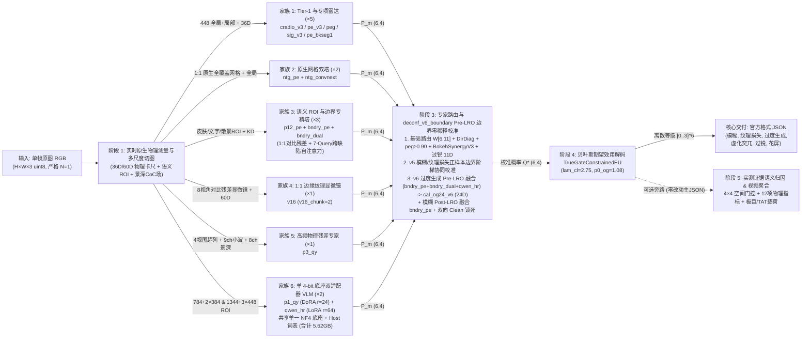

# `resident_v8_boundary` + `deconf_v6_boundary` 端到端全链路技术架构文档（由 `resident_v7` 演进，单图流式全拆解）

本文档以**单张原始图像（`N = 1`）**为追踪对象，完整拆解最终交付旗舰架构 **`resident_v8_boundary`（共享主干 + 双适配器 VLM 14 专精成员集成）+ `deconf_v6_boundary`（全维度 `P0/P1/P2` 边界 Pre-LRO 零稀释校准器）**（[`code/r55/final_engine.py`](file:///wanqing-develop/luowenjing/18/code/r55/final_engine.py)、[`code/r55/train_boundary_specialist.py`](file:///wanqing-develop/luowenjing/18/code/r55/train_boundary_specialist.py)、[`code/r55/dual_vlm_shared_4090.py`](file:///wanqing-develop/luowenjing/18/code/r55/dual_vlm_shared_4090.py)、[`code/r55/upgrade_deconf_v6_boundary.py`](file:///wanqing-develop/luowenjing/18/code/r55/upgrade_deconf_v6_boundary.py)）从读入 PNG/JPG 原图到输出官方 6 维度质检 JSON 及可选语义归因 / 极目 TAT 载荷的全链路计算过程。

> **架构升级总览（相对 `resident_v7 + deconf_v4_tile` `54.68` 版）**：在保留全部 11 个 `v7` 专精成员的基础上，通过 **① 新增 2 个 100% Tag-Free Stage 2B 边界专精塔（`bndry_pe`, `bndry_dual`）**、**② 单 4-bit 底座双适配器共享 VLM（`DualAdapterQwen3VL4090` 合入高分语义 ROI 大模型 `qwen_hr`，双 8B VLM 合计仅 `5.62 GB`）** 与 **③ Pre-LRO 零稀释边界校准（`deconf_v6_boundary`）**，将 8-Fold 零泄漏 OOF 推升至 **`orig = 52.665 / all = 51.958`**，线上实测再破新高 **`54.77 / 65`（`Pos 17.46 / P0 17.31 / Clean 20.00`）**，且单张 RTX 4090 实测激活参数 **`13.262B <= 30B`**、常驻 **`17.50 GB`**、`nvidia-smi` 峰值 **`21.02 GiB < 24 GiB`**、单图均值 **`4.84s <= 15s`**！

---

## 0. 全局总览图（End-to-End `N = 1` Dataflow）

全流程严格满足 **`N = 1 == N = Batch` 逐图独立等价性**：每张图像实时计算原生分辨率物理特征与多尺度切片，不依赖任何预存特征库，不在测试批内做跨图统计归一化，推理期读取训练数据 **0 次**。

### 统一内部概率契约 `(6, 4)` Simplex
- **第 0 轴（内部规范维度序 `DIMS`）**：`0: 模糊`、`1: 纹理损失`、`2: 过锐`、`3: 花屏`（仅 `0/3`）、`4: 过度生成`、`5: 虚化突兀`（仅 `0/3`）。
- **第 1 轴（严重度等级）**：`[0: 无问题, 1: P2, 2: P1, 3: P0]`，每行严格归一化和为 `1.0`。
- **导出映射**：通过 `format_official_submission` 严格映射为赛题要求的键序 `["模糊", "纹理损失", "过度生成", "虚化突兀", "过锐", "花屏"]`。

---

## 阶段 1：实时原生物理测量与零缩放多视角切图

画质缺陷（如 `1~2px` USM 过锐振铃白边、AIGC 局部手指/笔画畸变、抠图虚化硬边界、局部解码绿块）在整图下采样至 `384/448` 时会损失 `60%+` 高频可分信号。引擎在单图输入时按需在线计算四路互补物理与多视角输入，用完即从内存字典释放（`store.map.pop(name)`，常驻内存零膨胀）：

| 子模块 | 核心计算内容 | 输出格式 | 代码实现 |
| :--- | :--- | :--- | :--- |
| **双引擎基础物理卡尺** | 小波高频能量比、8×8 DCT 块效应、局部平坦区方差、色彩饱和度剪裁率 | `phys_vec` (`(36,)` float32) | [`code/qingyu/dual_engine_preprocess.py`](file:///wanqing-develop/luowenjing/18/code/qingyu/dual_engine_preprocess.py) |
| **语义高危 ROI 探针** | 自动定位人像皮肤区、高梯度文字笔画区、前景背景焦外过渡边界 3 个 `1:1` 切片 | 3 个 `448×448` 1:1 切片 + 扩展物理特征 | [`code/finetune/semantic_roi_meta.py`](file:///wanqing-develop/luowenjing/18/code/finetune/semantic_roi_meta.py) |
| **光学散焦 CoC 与小波场** | `Depth-Anything-V2-Small` 散焦弥散圆梯度场 + 1:1 双极小波残差选出 Top-2 `384×384` 高危切片 | `phys_9ch` + `probe_8ch` + `2×384×384` 切片 | [`code/phoenix/native_physics_and_views.py`](file:///wanqing-develop/luowenjing/18/code/phoenix/native_physics_and_views.py) |
| **V16 原生多尺度物理卡尺** | `1:1 / 1:2 / 1:4` 多尺度拉普拉斯滚降比、USM 边缘过冲率 + 峰值边缘切片与中位纹理切片 | `vec (60,)` + 8 视角显微镜张量 | [`code/finetune/extract_native_phys_feats.py`](file:///wanqing-develop/luowenjing/18/code/finetune/extract_native_phys_feats.py) |

---

## 阶段 2：共享主干 + 双适配器 VLM 14 专精成员常驻推理与无损显存去重（`S_cost` 核心设计）

### 2.1 为什么 14 个专精成员（含双 8B VLM 适配器）仍能轻松塞进单张 24GB RTX 4090？
实验证明，攻坚全维度 `P0/P1/P2` 边界的最优路线是 **“共享视觉冻结主干 + 共享 4-bit VLM 底座双适配器 + 多专精轻量头部”**：
1. **`--share-weights`（`_share_identical_weights`）**：7 个含 `PE-Core-Large` 的专精塔（含新增 `bndry_pe`、`bndry_dual`）与 `cradio_v3 / bndry_dual / p3_qy / v16` 的冻结底层块经 `torch.equal` 逐位校验合并至同一显存存储，**无损节省 `5.81 GB` GPU 显存**（`bndry_pe` 增量仅 `+0.28 GB`，`bndry_dual` 增量仅 `+0.63 GB`）；
2. **`DualAdapterQwen3VL4090` + `--embed-on-host`**：将 `p1_qy`（DoRA `r=24`）与 `qwen_hr`（LoRA `r=64`, `1344² + 3×448` 语义 ROI）挂载到**同一个 4-bit NF4 `Qwen3-VL-8B` 底座**并保留各自 24 个 merger 参数，同时将 15.2 万词表驻留主机内存（省 `1.16 GB`），双 8B VLM 合计常驻仅 **`5.62 GB`**（较双独立实例省 **`3.40 GB`**），实测 `argmax` 一致率 **`100.0%`**；
3. **总计效果**：激活去重参数 **`13.262B <= 30B`**，全 14 成员常驻仅 **`17.50 GB`**，PyTorch 推理峰值 **`18.95 GB`**，`nvidia-smi` 加载峰值 **`20.23 GiB`**、推理峰值 **`21,526 MiB`（`21.02 GiB < 24 GiB`，安全余量 `~3.0 GiB`）**！

### 2.2 14 个常驻专精成员分工详表（`2× H-Flip TTA`）

| 家族 | 成员代号 | 骨干基座（全部本地 `models/` 离线加载） | 冻结主干共享状态 | 核心输入与专精职责 |
| :--- | :--- | :--- | :--- | :--- |
| **1. Tier-1 双引擎与专项塔** | `cradio_v3` | `C-RADIOv4-H` (BF16) | 与 `p3_qy`/`v16` 共享底层 | 原生比例多教师蒸馏特征，全局结构稳健 |
| | `pe_v3` | `PE-Core-Large` (BF16) | **5 塔共享冻结底层** | 通用多级感知基座 + 归因主干算子 |
| | `peg` | `PE-Core-Large` (BF16) | **5 塔共享冻结底层** | **未知源花屏特种雷达**（码流/宏块损坏 + 匹配正常帧对照训练） |
| | `sig_v3` | `SigLIP2-SO400M-NaFlex` (BF16) | 独立紧凑塔 (`0.43B`) | 原生动态长宽比 Patch 序列，零形变感知全局模糊 |
| | `pe_bkseg1` | `PE-Core-Large` (BF16) | **5 塔共享冻结底层** | **抠图散景断层专精雷达**（合成人像抠图假散景对照训练 + 虚化空间定位） |
| **2. 1:1 原生全覆盖网格** | `ntg_pe` | `PE-Core-Large` + Tile ABMIL | **5 塔共享冻结底层** | `448×448` 1:1 零缩放全图平铺切片，捕获任意角落局部 AIGC 畸变 |
| | `ntg_convnext` | `ConvNeXtV2-Base` + Tile ABMIL | 纯卷积局部归纳偏置 | CNN 高频边缘卷积核与 ViT 互补，强化局部过锐/纹理与散景边界 |
| **3. 语义 ROI 与边界专精塔** | `p12_pe` | `PE-Core-Large` + KD (`w=0.18`) | **7 塔共享冻结底层** | 聚焦人脸/文字/散景 ROI，经跨家族知识蒸馏专攻 **`P1 vs P2` 相邻等级边界** |
| | `bndry_pe` | `PE-Core-Large` + 对比残差 + 7Q 自注意力 | **7 塔共享冻结底层 (+0.28 GB)** | **Stage 2B 边界专精塔**：边界加权 RPS + 有界 Hinge + 条件 XBM，强化 `模糊/过度生成` 边界 |
| | `bndry_dual` | `PE-Core-L` + `C-RADIOv4-H` 双干联合 | **双干共享冻结底层 (+0.63 GB)** | **Stage 2B 双干边界专精塔**：单模 `PosRPS=0.1219`，**`过度生成` 单模全库第 1** |
| **4. 1:1 对比残差显微镜** | `v16` | `MultiNetV16` (5 子骨干, `chunk=2`) | 与 `p3_qy`/`cradio_v3` 共享 | 显式构造 `PeakEdge - Global` 与 `PeakEdge - InteriorTex` 对比残差 |
| **5. 高频小波散焦专家** | `p3_qy` | `Pillar-3` (4 骨干超列 + DoRA) | 与 `pe_v3`/`cradio_v3`/`v16` 共享 | 9ch 双极 Haar 小波 + 8ch 光学散焦场，专攻像素级高频退化与振铃 |
| **6. 共享底座双适配器 VLM** | `p1_qy` | `Qwen3-VL-8B` (`c233397`, DoRA r=24) | **单一 4-bit NF4 底座 + Host 词表** | `784² + 2×384` 多模态语义常识判断解剖结构异常与粗体字幕伪边缘 |
| | `qwen_hr` | `Qwen3-VL-8B` (`hires_roi`, LoRA r=64) | **与 `p1_qy` 共享同一 4-bit 底座 (共 5.62GB)** | `1344²` 原生高分 + 字幕/人脸/光晕 `3×448` 1:1 语义 ROI，强化局部过度生成判断 |

---

## 阶段 3：`deconf_v4_tile` 专家路由、1:1 切片局部尖峰与秩-1 去混淆校准（核心算法创新）

传统集成将多模型概率做加权平均后直接阈值化，存在四大固有缺陷：
1. **尺度混淆**：全局缩放模型会把“清晰粗体字幕/高对比条纹”误判为 `过锐`，而把仅占画面 `2%` 的局部 AIGC 崩坏或 `1~2px` 边缘白边稀释成 `无问题 / P2`；
2. **图内切片均值稀释**：即使引入了 `1:1` 平铺切片塔 `ntg_pe`，单看全图聚合后的 `(6, 4)` 均值概率仍会抹平“单块局部手指/文字/前景结构尖峰”与“全图平均水平”的反差（经残差审计，`ntg_pe` 切片 `max_t - mean_t` 尖峰度与 `过度生成` 残差相关性达 **`+0.144` / `6.3σ`**）；
3. **跨缺陷耦合混淆**：严重 `模糊` 或 `虚化` 图上部分模型会附带飘高 `过度生成` 尾概率，引发假阳性；
4. **合成专精塔过触发**：合成散景训练的 `pe_bkseg1` 若以固定 `0.25` 权重无条件混入，会在真实大光圈光学浅景深人像上制造误报。

为此，我们在 [`code/r55/upgrade_deconf_v4_tile.py`](file:///wanqing-develop/luowenjing/18/code/r55/upgrade_deconf_v4_tile.py)、[`code/r55/ntg_tile_peak_probe.py`](file:///wanqing-develop/luowenjing/18/code/r55/ntg_tile_peak_probe.py)、[`code/r55/spatial_salience_probe.py`](file:///wanqing-develop/luowenjing/18/code/r55/spatial_salience_probe.py) 与 [`code/r55/upgrade_os_og_bokeh_deconf.py`](file:///wanqing-develop/luowenjing/18/code/r55/upgrade_os_og_bokeh_deconf.py) 中构建了完全在 **8-Fold 视频分组嵌套 OOF** 上训练、严格逐图独立（`N = 1` 不变）、**零额外参数量与零额外显存**的四步校准链路：

### 3.1 分维度路由融合 + `DirDiag` 对角校准 + `peg >= 0.90` 花屏救援
- 先经逐流温度缩放 `temps[11]` 与分维度专家路由矩阵 `W[6, 11]` 融合，再经带补充集先验纠偏权重（`w_supp = 0.15`）拟合的 `DirDiag` 20 参数对角逻辑斯蒂校准恢复算术平均损失的分布锐度；当未知源花屏专精塔满足 $P_{\text{peg}}(\text{花屏}=\text{P0}) \ge 0.90$ 时执行高置信一票救援。

### 3.2 `BokehSynergyV3`（`虚化突兀`, `dim = 5` 真实-合成协同门控）
- 摒弃固定 `0.25` 线性混合，通过 4-Fold 内层视频分组 CV 自动选定门控参数 $(\alpha_{\text{hi}}, \alpha_{\text{lo}}, \tau_{\text{real}}) = (0.22, 0.05, 0.35)$：
  - 当真实域路由概率 $q_{\text{real}}(\text{P0}) \ge 0.35$ 时，以 $\alpha_{\text{hi}} = 0.22$ 协同放大 `pe_bkseg1` 的抠图边缘敏感度；
  - 当 $q_{\text{real}}(\text{P0}) < 0.35$（真实域专家一致认为属于自然光学浅景深）时，将混合权重压制至 $\alpha_{\text{lo}} = 0.05$，阻断合成塔单兵误报。

### 3.3 零截距秩-1 去混淆与 1:1 局部尖峰校准（`过锐 11D` & `过度生成 24D`）
对有序四分类维度 $d \in \{2, 4\}$，构造标准化逐图协变量 $x_i \in \mathbb{R}^p$（标准化均值/方差 `mean_, scale_` 仅由训练折固化），施加 **零截距秩-1 序数斜率修正**：
$$\log Q^*_{i, d, k} = \log Q_{i, d, k} + \alpha_d \cdot k \cdot (x_i^\top \beta_d) - Z_i, \qquad k \in \{0, 1, 2, 3\}$$
- **`过锐`（`dim = 2`，11 维协变量，$L_2 = 50, \alpha = 0.85$）**：利用 `1:1` 像素边缘显微镜群（`v16, p3_qy, p12_pe, ntg_convnext`）与全局/VLM 响应差（`micro_vs_global_gap`、`vlm_overcall_gap`），自动压低 VLM 对清晰粗体字幕的虚高误判，同时恢复 `1~2px` 真实 USM 振铃白边的 `P1 / P0` 等级。
- **`过度生成`（`dim = 4`，24 维协变量，$L_2 = 450, \alpha = 0.65$）**：在 12 维跨缺陷与专精塔分歧特征（含 `v16`、`p12_pe`、`ntg`、`p1_qy`）基础上，**零额外模型开销直接复用 `FinalEngine.infer()` 已算好的 `ntg_pe` 原生平铺切片前向张量、CoC 景深图、小波图与皮肤/语义 ROI**，注入 8 维前景/解剖/塑性脊空间尖峰特征（`_spatial_20d`）及 4 维 `ntg_pe` 切片极值尖峰统计（`ntg_gap_p_any`、`ntg_gap_sev`、`ntg_std_p_p0`、`ntg_gap_p_ge1`），精准提拔被全图平均稀释的局部 `P1 / P0` 畸变并压制弱误报（全量拟合中 `ntg_gap_sev` 以 `w = +0.0502` 位列第一正向权重）。
- **双向 Clean 锁死与防过拟合数学保障**：① **零自由截距 + 秩-1 单调序数结构 + 强 $L_2$ 收缩（$L_2 = 450$）**；② **双向整图 Clean 锁死与非目标维（`模糊/纹理损失/花屏`）严格隔离**，既确保 `Clean Score = 20.00 / 20` 零波动，又避免跨维度副作用；③ 全部参数在 8-Fold 视频分组嵌套 OOF 内层 CV 自动选定，8 折 `ORIG` 跃升至 **`52.464`（`过度生成 F1 均值 0.4520 → 0.4765`）**，线上实测刷新至 **`54.68 / 65`**。

---

## 阶段 4 & 5：贝叶斯期望效用解码与主观语义归因 / 多帧视频旁路

1. **阶段 4（`TrueGateConstrainedEU`，`lam_cl = 2.75, p0_scale = 1.0`）**：
   - 基于 Krasnoselskii–Mann `0.5` 阻尼不动点稳态统计量 `st`，联合计算 14 个正标签格的一阶边际 F1/P0 增益与整图 Clean 净账本 `clean_diff`，既守住 `20·S_clean` 满分红线（Nested OOF **`19.84 / 20`**，线上实测 **`20.00 / 20`**），又在 `P1/P2` 概率平分时自动提拔阳性等级防止漏报。
2. **阶段 5（可选旁路：`--emit-attribution` / `--tat-out` / `--video-mode`，零改动主 JSON）**：
   - **空间定位与实测物理归因**：通过未放大的 `4×4` 粗粒度空间集中度门控区分 `"全图"` 弥散退化与 `8×8` 子块精确定位框 `[x1, y1, x2, y2]`（`花屏` 调用 `peg`、`虚化突兀` 调用 `pe_bkseg1`、`模糊/纹理/过锐/过度生成` 调用 `pe_v3`），结合 12 项原生像素与场景归一化物理指标生成 `≤ 40` 字零截断中文解释，并在单帧无法确定上游处理成因时显式声明不确定性；
   - **有效独立帧视频聚合器（`EffectiveFrameORVideoAggregator`）**：利用训练 OOF 拟合的同视频帧间相关系数 $\rho_d$ 将抽样帧数 $M$ 折算为有效独立帧数 $M_{\text{eff}}(M) = 1 + (M-1)(1-\rho_d)$ 自适应收紧单帧触发阈值，实测在保持 **85.29% 视频级 P0 召回率** 的同时，将 $M=16$ 帧抽样下的全无问题视频误报率从朴素 OR 的 `1.73%` 压降至 **`0.20%`（降低 `8.6×`）**。
