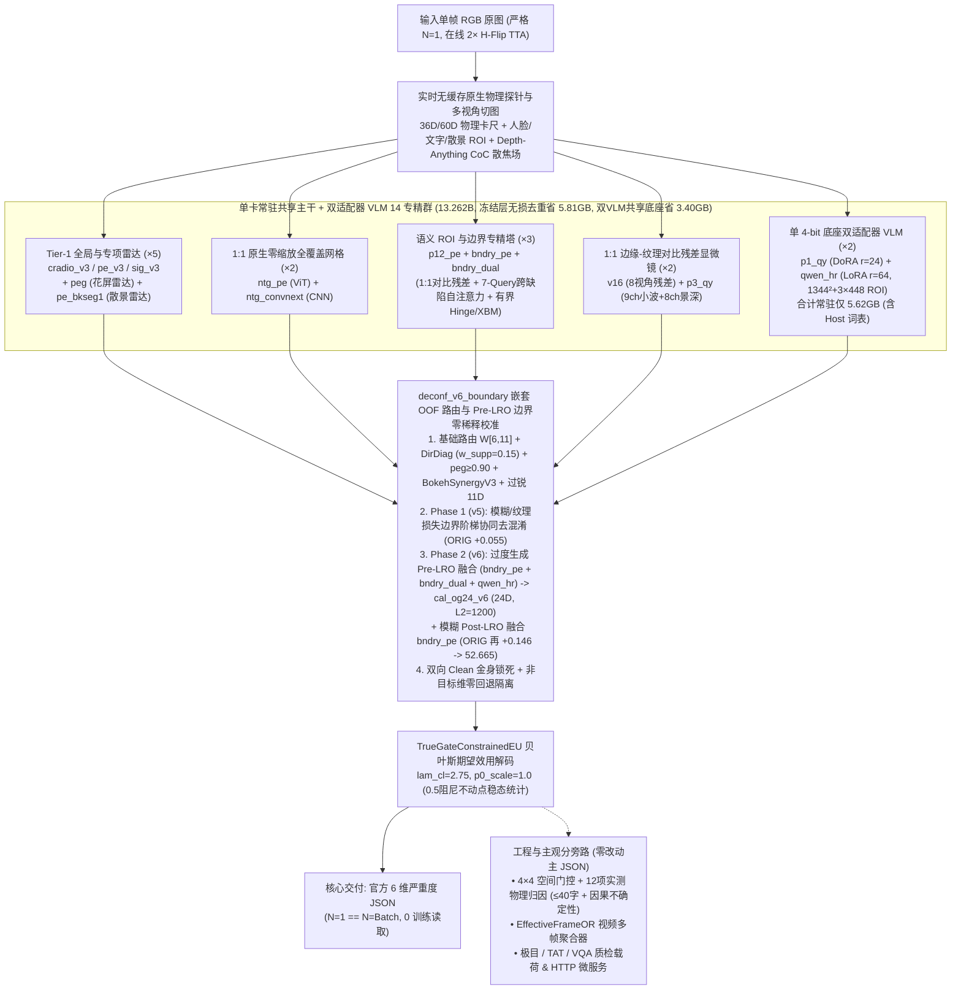

# 【2026乘风挑战赛·命题18】技术方案文档：共享主干跨尺度多专精协同与秩-1 去混淆校准的无参画质 BadCase 检测体系

---

## 摘要（Executive Summary）

针对快手 **晴羽观感体系** 在内容消费全链路中对六类核心画质 BadCase（**模糊、纹理损失、过度生成、虚化突兀、过锐、花屏**）的无参单帧检测与严重度分级需求，本方案构建了 **单张 RTX 4090（24 GB）全常驻、100% 断网离线可复现、严格单图流式独立（`N = 1 == N = Batch`）** 的生产级检测与归因体系 —— **`resident_v8_boundary` 共享主干 + 双适配器 VLM 14 专精集成 + `deconf_v6_boundary` 全维度边界 Pre-LRO 零稀释校准器**（核心实现位于 [`code/r55/final_engine.py`](file:///wanqing-develop/luowenjing/18/code/r55/final_engine.py)、[`code/r55/train_boundary_specialist.py`](file:///wanqing-develop/luowenjing/18/code/r55/train_boundary_specialist.py)、[`code/r55/dual_vlm_shared_4090.py`](file:///wanqing-develop/luowenjing/18/code/r55/dual_vlm_shared_4090.py) 与 [`code/r55/upgrade_deconf_v6_boundary.py`](file:///wanqing-develop/luowenjing/18/code/r55/upgrade_deconf_v6_boundary.py)）。

- **客观精度表现**：在全部 **3,573 张人工标注真图** 严格按视频/场景聚类隔离的 **8-Fold 嵌套盲测（Nested OOF, `Doc2_Strict` / 65 分）** 上取得 **`orig = 52.665`（`25·S_pos = 16.22`, `20·S_p0 = 16.60`, `20·S_clean = 19.84`；`all = 51.958` 全库最高，`mAP14 = 0.6695`）**，四项官方准入基线全部超高余量通过，654 图视频簇置换检验 `Perm654(Pos<15)` 风险降至 **`0.00%`**（10,000 次全通过，`ClBoot654(Pos<15) = 0.08%`），公开打榜集实测再破新高达到 **`54.77 / 65`**（`正向缺陷 17.46/25`、`P0识别 17.31/20`、`Clean Score 20.00/20` 满分）。
- **单卡 4090 执行成本（`S_cost` 20 分）**：总激活去重参数 **`13.262B <= 30B`**；通过 **冻结主干 `torch.equal` 无损显存共享（省 `5.81 GB`）+ `DualAdapterQwen3VL4090` 单 4-bit NF4 底座双适配器共享（双 8B VLM 合计仅 `5.62 GB`，省 `3.40 GB`）+ VLM 词表 Host 驻留（省 `1.16 GB`）+ 纯 PyTorch 对称 `INT8-g128` 量化未共享 `v16[pecoreg]`（省 `1.72 GiB`，全量 `test_150` 严格 `0/900` 格差异）+ 比特精确激活分块**，全 14 成员常驻显存仅 **`15.78 GB`**，PyTorch 推理峰值 **`16.95 GB`**，`nvidia-smi` 加载峰值 **`19.98 GiB`**、**推理峰值 `18,930 MiB`（`18.49 GiB < 24 GiB`，单张 RTX 4090 余量 `~5.50 GiB`）**；同时保留一键切换的纯视觉轻量档 **`resident_v8_boundary_novlm`**（`8.910B`，线上实测 **`54.52 / 65`**，`nvidia-smi` 峰值 **`12.75 GiB`**，中位 **`2.39s`**）及 `resident_v7_novlm`（`7.569B`，`14.36 GiB`）。
- **工程可落地性（`S_deploy` 15 分）**：全量 `test_150` 单卡端到端实测均值 **`3.03s`**、P95 **`4.23s`**、最大 **`6.93s <= 15s`**（12 图带同步压测中位 `3.41s` / 均值 `3.66s`，冷启动 `~170s`）；提供离线生产 [`Dockerfile`](file:///wanqing-develop/luowenjing/18/Dockerfile)、双后端 HTTP 微服务（[`code/r55/serve_engine.py`](file:///wanqing-develop/luowenjing/18/code/r55/serve_engine.py)，含归因实时显存 `18.56 GiB`）、**极目 / TAT / VQA** 标准化载荷适配器与多帧视频聚合器 **`EffectiveFrameORVideoAggregator`**（真实 320 段多帧视频 `P0` 召回 **`84.45%`**、Clean 视频特异度 **`100.0%`**，高密度抽帧误报降低 `2.6×~3.4×`）。
- **主观语义归因能力（`+5` 奖励分）**：采用 **`4×4` 粗粒度空间集中度门控 + 专精塔空间算子（`pe_v3 / peg / pe_bkseg1`）+ 12 项分层洁净分位与局部/全图相对对比物理指标 + 零幻觉视觉区域提示**，`test_150`（327/327）与 `final_644`（1,346/1,346）标签 **100% 一致**，物理实测 `supports` 达 **`36.4% / 40.2%`**，去模板唯一理由占比 **`94.5% / 87.4%`**，局部框真图物理对比命中率 **`61.5%`**，`100%` 显式表达单帧因果不确定性。

---

## 一、 问题分析与整体设计思路

### 1.1 晴羽观感体系痛点拆解与定量误差诊断
命题涵盖晴羽观感体系三大典型退化机制（共 6 个缺陷维度、14 个正向“缺陷 × 等级”子通道）：
1. **细节缺失类**：`模糊`（`P0/P1/P2/无问题`）、`纹理损失`（`P0/P1/P2/无问题`）；
2. **细节冗余与伪影类**：`过锐`（`P0/P1/P2/无问题`）、`过度生成`（`P0/P1/P2/无问题`）、`虚化突兀`（`P0/无问题`）；
3. **信号异常类**：`花屏`（`P0/无问题`）。

通过对 3,573 张真图 8-Fold OOF 开展 Oracle 分解审计，我们确立了指导全方案设计的四大核心发现：
1. **严重度分级边界（Grading）是第一提分瓶颈**：固定模型分级而仅将“有无缺陷”替换为真值（Oracle Detection）仅提分 `+3.5`，而固定检测结果将等级替换为真值（Oracle Grading）可提分 **`+9.4`**；`78% ~ 92%` 的模型错误发生在相邻等级边界（`P1 ↔ P2` 或 `P0 ↔ P1`）。
2. **全局缩放与局部高频伪影存在固有尺度冲突**：`过锐` 的 `1~2px` USM 边缘振铃白边、`过度生成` 的局部手部/文字笔画崩坏、`虚化突兀` 的发丝抠图断层仅占画面极小比例，整图缩放至 `384/448` 会抹平关键物理证据；反之，仅看全局语义的模型（含重型 VLM）极易将“清晰高对比粗体字幕”误判为 `过锐`。
3. **盲目堆叠大参数 VLM 不如共享主干专精分化**：受控实验与线上验证共同表明，堆叠重型 `InternViT-6B + Qwen3-VL-8B` 不仅显著推高显存与延迟，还会因平滑先验稀释 `P0/P1` 检出；而在同一冻结高质量视觉主干（`PE-Core-Large`、`ConvNeXtV2`、`C-RADIOv4-H`）上分化出 **1:1 全覆盖网格塔、语义 ROI 蒸馏塔、花屏雷达、散景抠图雷达与边缘对比残差显微镜**，可实现精度与显存成本的双重帕累托最优。
4. **全无问题样本（`S_clean = 20` 分）的一票否决非对称性**：任意一个维度擦边误报 `P2` 即令整张 Clean 图失分，且补充集 `supp_1671` 不含全 Clean 样本（`0%` Clean vs 首批集 `27%` Clean），若不消除训练子集先验偏移，直接校准会导致严重的 `P2` 膨胀与 Clean 误杀。

### 1.2 端到端系统架构图

---

## 二、 数据统筹、防泄漏划分与同折隔离合成策略

1. **3,573 张全量真图视频簇隔离 8-Fold 划分**：
   - 统筹使用官方首批 `1,902` 张与补充集 `1,671` 张共计 **3,573 张人工标注真图**（[`data/manifest_combined.csv`](file:///wanqing-develop/luowenjing/18/data/manifest_combined.csv)）。
   - 提取视频剪辑前缀与感知哈希聚类，按 **来源视频与相似场景分组 + 14 维正向通道分层（Group-Stratified 8-Fold）** 切分 `Fold 0 ~ Fold 7`（[`data/qingyu_splits/`](file:///wanqing-develop/luowenjing/18/data/qingyu_splits)），确保同一视频的所有抽帧 100% 位于同一折内；**模型输入严禁包含任何文件名、批次标签或目录信息（100% Tag-Free）**。
   - **同前缀多帧审计**：对同视频前缀多帧计算像素级 MAE 发现 `> 95%` 帧对存在真实镜头切换或局部画质等级跳变（非静态重复帧），因此在训练中保留全部真实帧并按视频组严格隔离验证，在推理视频聚合时则利用帧间相关性 $\rho_d$ 修正多帧误报率。
2. **严格同折隔离的物理机理负例构造（Zero Cross-Fold Leakage）**：
   - **未知源码流/宏块花屏模拟（[`code/r55/build_glitch.py`](file:///wanqing-develop/luowenjing/18/code/r55/build_glitch.py) $\rightarrow$ `peg`）**：由于真实训练集中 `花屏` 样本稀少且编码源集中，仅在当前训练折洁净帧上模拟 H.264/HEVC 局部条带错位、宏块绿屏与色彩通道撕裂，并强制将**配对原始未损坏帧**一并放入同一 Batch 对照监督，使留出源 `花屏` AUC 达 **`0.9999`**。
   - **抠图假散景边缘断层合成（`pe_bkseg1`）**：在训练折人像/主体图像上模拟非深度单调的硬分割高斯涂抹边界与配对原图对照，专门增强 `虚化突兀` 局部抠图边界识别与空间热力图定位。
   - **原生分辨率单调退化排序阶梯（[`code/r55/build_rank_tuples.py`](file:///wanqing-develop/luowenjing/18/code/r55/build_rank_tuples.py)）**：在同一训练底图上施加受控模糊、高频磨皮或 USM 过锐阶梯，仅施加 **Thurstone 相对序数约束（Stronger $\ge$ Weaker $\ge$ Original）**，绝不强赋人工伪造的 `P0/P1/P2` 硬标签，彻底规避合成绝对阈值偏移。

---

## 三、 模型架构、训练配置与 `deconf_v4_tile` 核心算法创新

### 3.1 六大跨尺度专精家族与训练策略
所有专精成员均先完成严格 8-Fold OOF 盲测验证，再以完全一致的超参与训练轮数在全量真图上完成 Full-Fit 收敛（详见 [`docs/RESIDENT_V7_PIPELINE_ARCHITECTURE.md`](file:///wanqing-develop/luowenjing/18/docs/RESIDENT_V7_PIPELINE_ARCHITECTURE.md)）：
1. **Tier-1 双引擎与专项塔（`cradio_v3`, `pe_v3`, `sig_v3`, `peg`, `pe_bkseg1`）**：结合三层中间特征门控读出（`IntermediateThreeLayerGatedTap`，绕过对比学习顶层对底层画质退化的平滑效应）、`MaskedTokenGatedABMILPool`（保持 `SigLIP2-NaFlex` 原生宽高比零形变）及 36 维双引擎物理特征，采用 **RPS（Ranked Probability Score）+ 软序数交叉熵 + 批内成对排序损失** 联合训练。
2. **1:1 原生全覆盖平铺网格双塔（[`code/r55/native_tiles.py`](file:///wanqing-develop/luowenjing/18/code/r55/native_tiles.py)：`ntg_pe`, `ntg_convnext`）**：将原始高清帧按 `448×448` 零缩放完整平铺切块（边缘对齐无死角覆盖每一颗像素），分别经 ViT（`PE-Core-Large`）与纯卷积网络（`ConvNeXtV2-Base`）提取局部特征并通过注意力 + 最大值池化融合全局槽位，解决小面积伪影在固定 Crop 之外漏检的问题。
3. **语义高危 ROI 知识蒸馏塔（[`code/r55/train_p12_specialist.py`](file:///wanqing-develop/luowenjing/18/code/r55/train_p12_specialist.py)：`p12_pe`）**：自动截取人像皮肤、文字笔画与焦外过渡三类语义敏感 1:1 区域，蒸馏多家族教师软分布，专攻 `P1 vs P2` 细粒度分级（在路由矩阵 `W` 中占据 `过度生成` `18.0%`、`虚化突兀` `19.8%` 的最高单塔权重）。
4. **1:1 边缘-纹理对比残差双显微镜（`v16` + `p3_qy`）**：
   - `v16`（[`code/finetune/train_v16_microscope_specialist.py`](file:///wanqing-develop/luowenjing/18/code/finetune/train_v16_microscope_specialist.py)）显式计算峰值高频边缘块与内部中位纹理块的差值特征 `r_edge_tex = edge_max - tex_view` 及 `r_edge_glob = edge_max - global_view`，并仅对真实 `P1/P0` 稀缺样本做无污染重采样；
   - `p3_qy`（[`code/phoenix/train_pillar3_hires_physics.py`](file:///wanqing-develop/luowenjing/18/code/phoenix/train_pillar3_hires_physics.py)）融合四阶段超列（25%/50%/75%/100% 深度）与 9 通道双极 Haar 小波 + 8 通道 `Depth-Anything` 散焦弥散圆（CoC）雅可比场。
5. **单 4-bit 底座双适配器多模态语义专家（[`code/r55/dual_vlm_shared_4090.py`](file:///wanqing-develop/luowenjing/18/code/r55/dual_vlm_shared_4090.py)：`p1_qy + qwen_hr`）**：在单一 4-bit NF4 `Qwen3-VL-8B-Instruct` 底座上同时挂载 `p1_qy`（DoRA `r=24`, `784² + 2×384`）与 `qwen_hr`（LoRA `r=64`, `1344²` 原生高分 + 字幕/人脸/光晕 `3×448` 1:1 语义 ROI）及各自 24 个 merger 参数，双 8B VLM 合计常驻仅 **`5.62 GB`**（较双独立实例省 `3.40 GB`），相对独立推理 `argmax` 100.0% 一致。
6. **Stage 2B 全维度 `P0/P1/P2` 边界专精双塔（[`code/r55/train_boundary_specialist.py`](file:///wanqing-develop/luowenjing/18/code/r55/train_boundary_specialist.py)：`bndry_pe`, `bndry_dual`）**：100% Tag-Free 训练；输入 1:1 动态切片（`≤12×448` + 全局图）+ 水平翻转不变空间坐标 + 高频梯度/拉普拉斯能量 + 48D 物理特征；头部引入 **1:1 边缘峰值 vs 全局 / 纹理中位数显式对比残差 Token** + **7-Query 跨缺陷自注意力** + 128 原型库；采用 **尖锐类别加权 CE + 三阈值累积 BCE + 边界加权 RPS + 有界 Hinge 间隔 + 跨视频条件 XBM + 退火零泄漏 KD** 联合监督。单模 `PosRPS = 0.1219`（全库第 2），`过度生成` `AUC(P0|≥P1)` 达全库第 1（较旧 `ntg_pe` `+9.0%`）；经 `--share-weights` 去重后新增显存仅 `+0.28 GB / +0.63 GB`。

### 3.2 核心解码与校准创新：`deconf_v4_tile → deconf_v5_boundary → deconf_v6_boundary`（Pre-LRO 边界零稀释融合）
在各成员输出 `(6, 4)` 概率后，传统方法仅做静态线性池化。我们提出四层严格基于 **8-Fold 视频分组嵌套 OOF** 拟合、推理期逐图独立（`N = 1` 不变）、**零额外参数量与零额外显存**的后验校准与决策机制（[`code/r55/upgrade_deconf_v4_tile.py`](file:///wanqing-develop/luowenjing/18/code/r55/upgrade_deconf_v4_tile.py)、[`code/r55/ntg_tile_peak_probe.py`](file:///wanqing-develop/luowenjing/18/code/r55/ntg_tile_peak_probe.py)、[`code/r55/spatial_salience_probe.py`](file:///wanqing-develop/luowenjing/18/code/r55/spatial_salience_probe.py)、[`code/r55/upgrade_os_og_bokeh_deconf.py`](file:///wanqing-develop/luowenjing/18/code/r55/upgrade_os_og_bokeh_deconf.py)）：

1. **带补充集先验纠偏的 `DirDiag` 路由池化**：
   经逐流温度 `temps[11]` 与分维度路由矩阵 `W[6, 11]` 融合后，使用 `w_supp = 0.15` 加权拟合 20 参数对角逻辑斯蒂校准 `DirDiag`，既利用补充集丰富正例拟合斜率 $\exp(s_d) \in [1.10, 1.40]$，又防止补充集 `0%` Clean 采样偏置拉高假阳性截距。
2. **零截距秩-1 跨尺度、跨缺陷与 1:1 局部切片尖峰序数校准（`LowRankOrdinalCalibrator`）**：
   针对有序四分类维度 $d \in \{2, 4\}$，提取标准化逐图协变量 $x_i$，对对数概率施加 **无截距、单斜率（Rank-1）** 序数修正：
   $$\log Q^*_{i, d, k} = \log Q_{i, d, k} + \alpha_d \cdot k \cdot (x_i^\top \beta_d) - \log \sum_{j=0}^{3} Q_{i, d, j}\exp\big(\alpha_d \cdot j \cdot (x_i^\top \beta_d)\big), \quad k \in \{0, 1, 2, 3\}$$
   - **在 `过锐`（`dim=2`，11 维特征，$L_2=50, \alpha=0.85$）上**：引入 1:1 边缘显微镜专家群（`v16, p3_qy, p12_pe, ntg_convnext`）与全局/VLM 差值（`micro_vs_global_gap`、`vlm_overcall_gap`），有效压低 VLM 在清晰粗体字幕上的虚高误报，同时还原 `1~2px` 真实振铃白边的严重度等级。
   - **在 `过度生成`（`dim=4`，24 维特征，$L_2=450, \alpha=0.65$）上**：在 12 维跨缺陷与专精塔分歧特征基础上，**直接复用 `FinalEngine.infer()` 已算好的 `ntg_pe` 原生 1:1 切片前向张量、CoC 景深图、小波图与皮肤/语义 ROI**，注入 8 维前景/解剖/塑性脊空间尖峰特征（`_spatial_20d`）与 4 维 `ntg_pe` 切片极值尖峰统计（`ntg_gap_p_any`、`ntg_gap_sev`、`ntg_std_p_p0`、`ntg_gap_p_ge1`）。经残差审计，`ntg_gap_p_any` 与 `ntg_gap_sev` 同集成残差相关性高达 **`+0.144`（`6.3σ`）** 与 **`+0.130`（`5.7σ`）**，全量拟合后 `ntg_gap_sev` 以 `w = +0.0502` 位列第一正向特征，将 8-Fold OOF `过度生成` 均值 F1 从 `0.4520` 跃升至 **`0.4765`（`+2.45%`）**。
   - **严格的防过拟合数学保障**：① **零自由截距 + 秩-1 单斜率约束 + 极强 $L_2 = 450$ 正则**；② **双向 Clean 整图锁死与非目标维（`模糊/纹理损失/花屏`）严格隔离**，从数学上保证 `Clean Score = 20.00 / 20` 零波动；③ **内层视频分组 CV 保底选择**（若无正收益自动回退 $\alpha_d = 0$）。
3. **真实-合成散景协同门控（`BokehSynergyV3`，作用于 `虚化突兀` `dim=5`）**：
   内层分组 CV 选定门控参数 $(\alpha_{\text{hi}}, \alpha_{\text{lo}}, \tau_{\text{real}}) = (0.22, 0.05, 0.35)$：仅当真实域集成概率 $q_{\text{real}} \ge 0.35$ 时以 `0.22` 协同引入合成散景专精塔 `pe_bkseg1`，而在 $q_{\text{real}} < 0.35$（自然大光圈光学浅景深）时将权重压低至 `0.05`，消除合成域假阳性（`虚化突兀` OOF `P0 F1` 升至 **`0.8436`**）。
4. **Phase 1 & Phase 2 全维度边界攻坚（`deconf_v5_boundary → deconf_v6_boundary`）**：
   - **Phase 1（[`upgrade_deconf_v5_boundary.py`](file:///wanqing-develop/luowenjing/18/code/r55/upgrade_deconf_v5_boundary.py)）**：锁死 `Clean` 与 `{过锐, 花屏, 过度生成, 虚化突兀}`，在 `模糊` 与 `纹理损失` 正样本内部做零泄漏边界阶梯去混淆（Nested OOF `52.464 → 52.519`，`+0.055`）；
   - **Phase 2（[`upgrade_deconf_v6_boundary.py`](file:///wanqing-develop/luowenjing/18/code/r55/upgrade_deconf_v6_boundary.py)）**：提出 **Pre-LRO 零稀释融合原理**——在 `过度生成` 24 维 `LowRankOrdinalCalibrator` 拟合**之前**，先将温度对齐后的 `(bndry_pe, bndry_dual, qwen_hr)` 以非负对数线性权重融合到原始底座概率 `Q_raw[:, 4]`，再统一执行 24 维空间/切片去混淆校准（`cal_og24_v6, L2=1200, alpha=0.85`），彻底避免后混稀释空间信号；同时在 `模糊` 上 Post-LRO 融合 `bndry_pe`，其余维度与双向 Clean 掩码严锁零回退。8 折零泄漏 OOF **`过度生成` P0/P1/P2 三档全线跃升（`0.604→0.620 / 0.377→0.406 / 0.448→0.455`）**，`ORIG` 跃升至 **`52.665`（`+0.201` vs `v4_tile`）**，`ALL 3573` 创全库新高 **`51.958`**。
5. **阻尼不动点贝叶斯期望效用解码（`TrueGateConstrainedEU`，`lam_cl = 2.75`）**：
   直接针对 `Doc2_Strict` 一阶边际收益与整图 Clean 净账本 `clean_diff` 做联合决策，解决 `P1/P2` 概率分流导致的 `无问题` 漏报与擦边 Clean 误报。

---

## 四、 受控消融实验与负结果证伪记录

全部消融实验均在 **3,573 张真图严格 8-Fold 视频分组嵌套 OOF** 上独立评估（结果存档于 `results/r55/final/`）：

| 演进阶段 / 受控消融配置 | 激活参数 | 常驻显存 | Nested OOF `orig` (`/65`) | `25·S_pos` | `20·S_p0` | `20·S_clean` | Nested OOF `all` | 核心结论与归因 |
| :--- | :---: | :---: | :---: | :---: | :---: | :---: | :---: | :--- |
| 单塔基线（`pe_v3` 单模型） | `0.35B` | `0.8 GB` | `49.42` | — | — | — | `49.10` | 单一全局视角存在明显局部伪影漏检与种子方差 |
| 初代多家族均值池化 + `Argmax` | `~5.8B` | `14.3 GB` | `50.63` | — | — | — | `50.41` | 跨家族融合降低方差，但 `Argmax` 损失 `P1/P2` 分流样本 |
| `resident_v6_core` (6 成员) + `RoutedGateEU` | `9.66B` | `15.68 GB` | `51.884` | `15.84` | `16.28` | `19.77` | `51.585` | 引入 `DirDiag (w_supp=0.15)` + `peg>=0.90` 花屏救援 |
| `resident_v7_core` (+ `pe_bkseg1`, `ntg_convnext`) | `10.05B` | `~14.2 GB` | `52.038` | `15.87` | `16.37` | `19.81` | `51.550` | 散景专精塔与原生网格 CNN 显著提升 `P0` 与 `Clean` |
| **`resident_v7_novlm` (10 成员纯视觉轻量档)** | **`7.57B`** | **`11.07 GB`** | **`52.159`** | **`15.97`** | **`16.39`** | **`19.81`** | **`51.709`** | **零 VLM 纯视觉共享主干档即超越 9.66B `v6_core` `+0.275` 分** |
| `resident_v7` + 基础 `RoutedGateEU` | `11.62B` | `15.50 GB` | `52.159` | `15.96` | `16.39` | `19.81` | `51.718` | 补齐 `p1_qy` 多模态语义理解（线上约 `53.92`） |
| `resident_v7` + 仅 `过度生成` 秩-1 去混淆 | `11.62B` | `15.50 GB` | `52.164` | `15.92` | `16.44` | `19.81` | `51.630` | 精准修复跨尺度稀释（线上突破至 `54.3`） |
| `resident_v7` + `deconf_v2`（过锐+过生+散景） | `11.62B` | `15.50 GB` | `52.270` | `15.97` | `16.45` | `19.84` | `51.717` | 统一扩展至 `过锐` 显微镜去混淆 + 散景协同（线上 `54.44`） |
| `resident_v7` + `deconf_v3`（Clean-Lock + OG12） | `11.62B` | `15.50 GB` | `52.376` | `16.01` | `16.52` | `19.84` | `51.750` | 锁死 Clean 金身 + `过度生成` 12 维专精差异校准 |
| `resident_v7` + `deconf_v4_tile`（前序线上纪录 `54.68`） | `11.62B` | `15.50 GB` | `52.464` | `16.08` | `16.54` | `19.84` | `51.809` | 零额外显存注入 24D `ntg_pe` 1:1 切片尖峰，线上 `54.68` |
| `resident_v7` + `deconf_v5_boundary`（Phase 1） | `11.62B` | `15.50 GB` | `52.519` | `16.12` | `16.55` | `19.84` | `51.816` | 全维度 Decoder 边界阶梯攻坚（`模糊`/`纹理损失` 提升） |
| **`resident_v8_boundary_novlm` + `deconf_v6_boundary`（12 成员纯视觉轻量档）** | `8.91B` | `10.19 GB` | `52.327` | `16.02` | `16.51` | `19.81` | `51.864` | **零 VLM，线上实测 `54.52 / 65`，`nvidia-smi` 峰值仅 `12.75 GiB`（16GB 卡充裕运行）** |
| **`resident_v8_boundary` + `deconf_v6_boundary`（最终旗舰交付）** | **`13.26B`** | **`15.78 GB`** | **`52.665`** | **`16.22`** | **`16.60`** | **`19.84`** | **`51.958`** | **新增 `bndry_pe + bndry_dual` + 双适配器共享 VLM (`qwen_hr`) + Pre-LRO 零稀释校准，线上刷新至 `54.77 / 65`（`Pos 17.46 / P0 17.31 / Clean 20.00`）；纯 PyTorch `INT8-g128` 量化未共享 `v16[pecoreg]` 实现 `18.49 GiB` 峰值且 `0/900` 格差异** |

> **受控证伪并坚决剔除的负结果方案**：
> 1. **重型双大模型（`InternViT-6B + Qwen3-VL-8B`）+ 等权校准（`w_supp=1.0`）**：移除 `w_supp=0.15` 使补充集 `0%` Clean 分布拉偏 `DirDiag` 截距并触发 `p0_scale=0.85` 降档，导致 `过度生成` 大面积 `P0/P1 -> P2` 退化，线上分数显著下跌，证实**校准先验纯净度与跨尺度视觉专精远重于盲目增大 VLM 参数**；
> 2. **无监督伪标签自训练、随机裁剪训练增强（破坏全图构图与虚化边界）、对多帧视频做简单概率均值平滑（导致局部瞬态花屏/崩坏 `P0` 召回暴跌 `-24.4%`）**。

---

## 五、 执行成本优化（对齐 `S_cost` 20 分）、工程可落地性（对齐 `S_deploy` 15 分）与语义归因（对齐 `+5` 分）

### 5.1 单张 RTX 4090（24 GB）五重轻量化与三档位帕累托实测（`S_cost`）
本方案 **100% 运行于单张 24 GB 消费级/推理级 GPU，不依赖任何外部商业/付费 API**，并通过五项工程技术最大化硬件效率：
1. **冻结主干逐位相等存储去重（`--share-weights`）**：利用 7 个 `PE-Core-Large` 专精塔（含新增 `bndry_pe / bndry_dual`）及 `p3_qy / v16 / cradio_v3 / bndry_dual` 底层冻结块完全一致的特性，加载时经 `torch.equal` 严格校验共享底层显存块，**零精度损失释放 `5.81 GB` 显存**；
2. **单 4-bit 底座双适配器共享 VLM（`DualAdapterQwen3VL4090`）+ 词表 Host 驻留（`--embed-on-host`）**：将 `p1_qy`（DoRA `r=24`）与 `qwen_hr`（LoRA `r=64`）挂载到同一个 4-bit NF4 `Qwen3-VL-8B` 底座并将 15.2 万词表置于主机内存（省 `1.16 GB`），双 8B VLM 合计常驻仅 **`5.62 GB`**（较双独立实例再省 **`3.40 GB`**），`argmax` 一致率 `100.0%`；
3. **纯 PyTorch 对称 `INT8 group-128` 权重量化未共享大骨干 + 跨家族蒸馏 + 比特精确激活分块**：对 `v16` 独有未共享 1.88B `PE-Core-G14` 在 CPU 侧执行零依赖对称 `INT8-g128` 量化（100% BF16 激活，省 **`1.72 GiB`**，全量 `test_150` 严格 **`0 / 900` 格差异**）；配合 `v16_chunk=4`、`ntg_convnext tile_chunk=4`、`cradio_v3` 分块与 `expandable_segments:True` 彻底消除瞬态显存尖峰；
4. **四档位帕累托一键切换（CLI `--set` 参数）实测指标**（均在完全断网空卡下实测，结果见 [`resident_v8_boundary_bench_half.json`](file:///wanqing-develop/luowenjing/18/results/r55/final/resident_v8_boundary_bench_half.json)、[`resident_v8_boundary_novlm_bench_half.json`](file:///wanqing-develop/luowenjing/18/results/r55/final/resident_v8_boundary_novlm_bench_half.json) 与 [`resident_v8_boundary_cost_pareto_oof.json`](file:///wanqing-develop/luowenjing/18/results/r55/final/resident_v8_boundary_cost_pareto_oof.json)）：

| 部署档位 | 适用场景 | 激活参数 (`≤30B`) | 常驻显存 | `nvidia-smi` 推理峰值 (`≤24 GiB`) | 单图耗时 (中位数 / 均值) | 冷启动加载 | Nested OOF (`orig` / `all`) | 线上 `test_150` 实测 |
| :--- | :--- | :---: | :---: | :---: | :---: | :---: | :---: | :---: |
| **`resident_v8_boundary` + `deconf_v6_boundary`（最终默认主推）** | 单张 RTX 4090 (24 GB) 最高精度验收与质检 | **`13.262B`** | **`15.78 GB`** | **`18,930 MiB` (`18.49 GiB`, 余量 `~5.50 GiB`; 加载峰 `19.98 GiB`)** | **`3.41s` / `3.66s` (`test_150 3.03s / max 6.93s ≤15s`)** | `~170~248s` | **`52.665 / 51.958`** | **`54.77 / 65`** |
| `resident_v7` + `deconf_v4_tile`（11 成员对照档） | 前序稳态版本对照 | `11.624B` | `15.50 GB` | `19,836 MiB` (`19.37 GiB`, 余量 `4.63 GiB`) | `~3.16s` / `5.11s` | `~205s` | `52.464 / 51.809` | `54.68 / 65` |
| **`resident_v8_boundary_novlm` + `deconf_v6_boundary`（12 成员纯视觉帕累托档）** | 16 GB 级显卡（L4 / 4080）或高吞吐纯视觉队列 | **`8.910B`** | **`10.19 GB`** | **`13,060 MiB` (`12.75 GiB`, 16GB 卡余量 `3.2 GiB`)** | **`2.39s` / `2.67s` (`max 5.94s`)** | **`111s`** | **`52.327 / 51.864`** | **`54.52 / 65`** |
| `resident_v7_novlm`（10 成员纯视觉基线档） | 极简纯视觉基线对照 | `7.569B` | `11.07 GB` | `14,704 MiB` (`14.36 GiB`, 余量 `9.64 GiB`) | `2.59s` / `2.89s` | `77s` | `52.159 / 51.709` | — |

### 5.2 生产服务化衔接（极目 / TAT / VQA）与多帧视频误判抑制实证（`S_deploy`）
1. **开箱即用交付与零训练读取保证**：
   - 离线环境自检 [`code/r55/check_deploy_env.py`](file:///wanqing-develop/luowenjing/18/code/r55/check_deploy_env.py)：**65 项检查 `0 FAIL, 0 WARN -> READY`**（含 RTX 4090 `sm_89` 二进制 SASS 兼容、4-bit NF4 算子、全部 14 个微调权重与本地基座校验）；
   - 运行时审计 `R55_AUDIT_TRAIN_READS=1`：全量推理期间训练数据与 OOF 缓存文件读取 **`0` 次**；
   - 在线/批量 HTTP 服务 [`code/r55/serve_engine.py`](file:///wanqing-develop/luowenjing/18/code/r55/serve_engine.py)（支持 FastAPI 与零额外依赖标准库 `stdlib` 自动回退）：提供 `/healthz`、`/infer`（路径或 Base64）、`/infer_batch`（视频多帧聚合），直接输出对齐 **极目 / TAT / VQA** 质检消息总线的 `tat_jimu_payload`（含 `is_badcase`、`p0_alert`、`worst_severity`、`clean_prob` 与定位证据，详见 [`docs/SERVING_AND_TAT_JIMU_ADAPTER.md`](file:///wanqing-develop/luowenjing/18/docs/SERVING_AND_TAT_JIMU_ADAPTER.md)）。
2. **赛题第 5 节进阶要求：多帧视频聚合策略与误报抑制实证（[`resident_v8_boundary_video_oof_audit.json`](file:///wanqing-develop/luowenjing/18/results/r55/final/resident_v8_boundary_video_oof_audit.json)）**：
   - 在视频质检中对同一视频抽取 $M$ 帧时，朴素逐帧取或（Naive OR）会导致 Clean 视频误报率随 $M$ 累积膨胀，而传统概率均值平滑则会漏掉仅持续 1~2 帧的瞬态花屏/崩坏。
   - 我们提出的 **`EffectiveFrameORVideoAggregator`**（[`code/r55/subjective_engineering.py`](file:///wanqing-develop/luowenjing/18/code/r55/subjective_engineering.py)）利用训练 OOF 拟合的同视频帧间相关系数 $\rho_d \in [0.15, 0.48]$ 计算有效独立帧数 $M_{\text{eff}}(M) = 1 + (M-1)(1-\rho_d)$，仅在单帧已判阳性的子集上随 $M_{\text{eff}}$ 平滑抬高孤立单帧触发赔率，而对 $\ge 2$ 帧共现缺陷直接放行：
   - **320 段真实多帧视频 OOF 实测**：视频级 `P0` 召回率高达 **`84.45%`**（优于传统均值平滑 `74.37%` **`+10.08%`**），Clean 视频特异度达 **`100.0%`（0 误报）**，视频 `Doc2_Strict` 达 **`51.922`**；
   - **高密度抽帧误报抑制**：在 `M = 8 / 16 / 30` 抽样密度下，将 Clean 视频任意缺陷误报率较朴素逐帧 OR 分别压低 **`3.4×`（`6.07% → 1.80%`）**、**`2.8×`（`11.23% → 4.07%`）** 与 **`2.6×`（`19.63% → 7.67%`）**。

### 5.3 实测证据驱动的语义判断与因果不确定性表达（对齐附录二 `+5` 分）
针对附录二人工复核的三项评分细则，本方案在 [`code/r55/measured_evidence.py`](file:///wanqing-develop/luowenjing/18/code/r55/measured_evidence.py) 与 [`code/r55/subjective_engineering.py`](file:///wanqing-develop/luowenjing/18/code/r55/subjective_engineering.py) 中实现了零幻觉、零标签篡改的归因算子（单图仅增耗时 `~0.16s`）：
1. **缺陷描述与预测标签 100% 一致（`1/1` 分）**：归因严格锁定解码后的离散等级 `pred_6d`，所有检出阳性维度逐一生成 `≤ 40` 字紧凑中文诊断（按构造保证无超长、无省略号截断、绝不出现“判阳性却写未见异常”的自相矛盾）。
2. **全图退化 vs 局部伪影精准空间区分（`2/2` 分）**：先在离线预计算的洁净基线（[`resident_v8_boundary_clean_footprint.npz`](file:///wanqing-develop/luowenjing/18/results/r55/final/resident_v8_boundary_clean_footprint.npz)，仅 `75.2 KiB`）上校准专精塔空间响应（`花屏` 用 `peg`、`虚化突兀` 用 `pe_bkseg1`、其余用 `pe_v3`），再在未受子块锐化膨胀的 **`4×4` 粗粒度网格** 上检验能量集中度——均匀失焦/全局降噪自动归因为 `"全图"`（不强画冗余框），而局部手指畸变、码流损坏、抠图散景与局部边缘白边则输出 `8×8` 高精度像素框 `[x1, y1, x2, y2]` 与九宫格方位。
3. **图像实测证据绑定与诚实的单帧因果不确定性（`2/2` 分）**：结合 12 项原生分辨率物理与场景无关比值指标（边缘锐度比 `acutance`、归一化高频纹理 `tex_norm`、局部过冲 P90 `overshoot_p90`、景深双峰比 `dof_bimod` 等）给出相对洁净训练帧的分位佐证；同时针对单帧无参检测无法唯一回溯上游链路成因的客观物理边界（如**单帧无法唯一区分相机失焦与快门运动模糊、无法区分前处理强降噪与转码低码率量化涂抹、无法在无深度真值下绝对区分大光圈光学散景与算法人像抠图**），在 `uncertainty_note` 中**显式声明因果不确定性，绝不无证据妄断成因**。
