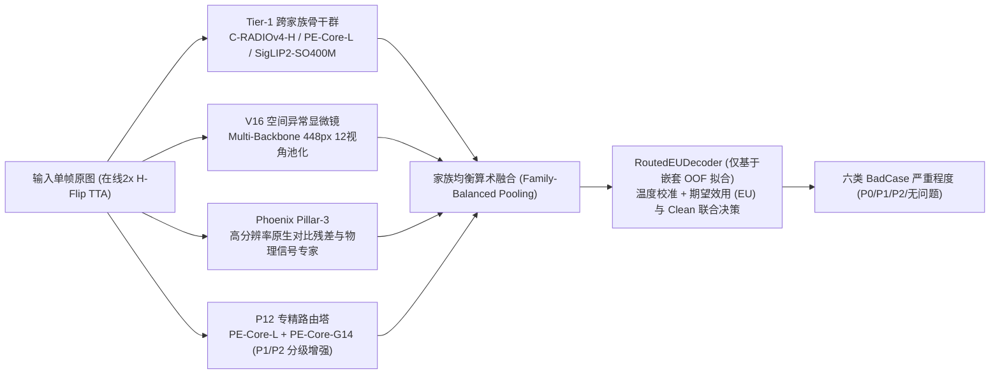

# 【2026乘风挑战赛·命题18】技术方案文档：跨家族高分辨率空间异常与物理先验协同的无参画质 BadCase 检测体系

---

## 一、 问题分析与方案设计思路

### 1.1 赛题核心痛点与误差诊断
本命题要求基于单帧图像（NR-IQA）对快手内容消费链路中的六类典型画质 BadCase（**模糊、纹理损失、过度生成、虚化突兀、过锐、花屏**）进行多标签识别与严重程度分级（四类评估 `P0 / P1 / P2 / 无问题`，`虚化突兀` 与 `花屏` 评估 `P0 / 无问题`，共计 14 个正向“缺陷 × 等级”子通道）。

通过对全部 **3,573 张人工标注真图**（首批 `1,902` 张 + 补充数据集 `1,671` 张）开展跨折误差审计与可控消融实验，我们定位了影响 `Doc2_Strict` 客观分（`25·S_pos + 20·S_p0 + 20·S_clean`）的核心瓶颈：
1. **单模型方差大且严重程度边界（Grading）是主要提分空间**：
   - 诊断表明，在 `s1` 8-Fold OOF 上，Oracle 检测（已知是否缺陷但用模型分级）仅提升 `+3.5` 分，而 **Oracle 分级（已知严重程度等级）可提升 `+9.4` 分**；其中 `P0` 边界决策驱动约 `30.7 / 65` 分。
2. **局部空间稀释与原生分辨率高频损耗**：
   - `过度生成`（多指/畸变纹理）、`虚化突兀`（主体与背景虚实断层）、`过锐`（高反差边缘白边 Halo）与 `花屏`（局部色块/解码错误）通常仅占画面局部区域，全局 Resize + Mean Pooling 会严重稀释异常响应。
3. **长尾缺陷样本稀缺与相邻等级混淆**：
   - `过度生成`、`虚化突兀`、`花屏` 样本量显著少于 `模糊`、`纹理损失`、`过锐`，且 `78% ~ 92%` 的错分仅相差一个等级（如 `P1 ↔ P2` 或 `P0 ↔ P1`）。
4. **全无问题样本（Clean）零容忍误报约束**：
   - `S_clean`（20 分）要求人工标注全无问题的样本在六类预测中 **全部** 判定为“无问题”，任一类别误报为 `P2/P1/P0` 即得 0 分。

### 1.2 整体架构设计：`resident_v3_giant` 跨家族协同推理体系
针对上述痛点，我们构建了单卡 RTX 4090 可常驻运行、端到端均值 **2.31 秒/图** 的跨家族协同检测体系（实现于 [`code/r55/final_engine.py`](file:///wanqing-develop/luowenjing/18/code/r55/final_engine.py)），由 **四大互补模型家族 + 路由期望效用解码器（`RoutedEUDecoder`）** 组成：

#### 核心模块说明：
1. **Tier-1 跨家族视觉表征塔（3 塔：`cradio_v3`, `pe_v3`, `sig_v3`）**：
   - 联合多教师蒸馏视觉基座 `C-RADIOv4-H`、感知编码器 `PE-Core-Large` 与细粒度图文对齐基座 `SigLIP2-SO400M-NaFlex`，采用潜变量序数严重度头（Latent Severity Head）与跨批次 Thurstone 排序损失 + RPS（Ranked Probability Score）联合训练。
2. **V16 多视角空间异常池化显微镜（`v16`）**：
   - 在 `448×448` 高分辨率下提取全局与局部切块特征，融合 `Global + Tile Mean + Top-2 Tile Anomaly Max-Mean + Tile Spatial Std` 四重空间池化，强化局部伪影捕获与虚实割裂感知。
3. **Phoenix Pillar-3 高分辨率物理信号专家（`p3`）**：
   - 针对 `过锐`、`纹理损失`、`模糊` 等像素级高频退化，在原生分辨率下引入对比残差（Contrast-Residual）4 视角局部增强与物理统计先验（[`code/phoenix/train_pillar3_hires_physics.py`](file:///wanqing-develop/luowenjing/18/code/phoenix/train_pillar3_hires_physics.py)）。
4. **P12 轻中度分级专精塔（`p12_pe`, `p12_g14`）**：
   - 基于 `PE-Core-Large` 与 `PE-Core-G14-448`，专门针对最易混淆的 `P1 / P2` 边界与 `过度生成` 进行精细化分级表征。
5. **家族均衡池化 + `RoutedEUDecoder` 解码器**：
   - 在完全零泄漏的 8-Fold Out-Of-Fold（OOF）概率上，先对各家族输出执行温度缩放校准与家族均衡加权，再通过期望效用最大化（Expected Utility, `eu_lam=0.25`）联合优化 `S_pos`、`S_p0` 与 `S_clean` 决策边界，**绝不读取或针对测试集调参**。

---

## 二、 数据使用与构造方法

1. **全量真图统筹与防泄漏 8-Fold 划分**：
   - 统筹使用官方全部 **3,573 张公开开发真图**（首批 `1,902` 张 + 补充数据集 `1,671` 张）。
   - 严格按 **来源视频与相似场景分组（Group Stratified 8-Fold）** 划分 `Fold 0 ~ Fold 7`（见 `data/qingyu_splits/`），确保同一视频或相似场景的所有帧严格落在同一折内，杜绝跨折数据泄漏；**文件名绝不作为模型输入特征**（仅在消融实验中用于辅助任务对照）。
2. **原生分辨率解码损坏模拟与排序阶梯构造（严格同折隔离）**：
   - **比特流/宏块花屏模拟（`build_glitch.py`）**：针对真实场景中 `花屏` 来源集中的问题，对训练折内正常视频帧进行真实编码/解码块损坏与匹配未损坏对照，提升跨来源泛化鲁棒性。
   - **原生分辨率排序阶梯（`build_rank_tuples.py`）**：在同一张训练折底图上构造 `模糊 / 纹理损失 / 过锐` 的单调退化序列，仅施加 **序数排序约束（Stronger ≥ Weaker ≥ Seed）**，不人为硬赋予 `P0/P1/P2` 绝对标签，避免合成标签偏移污染真实边界。
   - **多帧冗余与标签泄漏防护**：所有辅助数据的软标签均严格由对应折 `k` 的 Teacher 模型生成，验证折 `k` 对其 100% 不可见。

---

## 三、 训练配置与关键超参

- **训练框架**：[`code/r55/train_testbed.py`](file:///wanqing-develop/luowenjing/18/code/r55/train_testbed.py)、[`code/phoenix/train_pillar3_hires_physics.py`](file:///wanqing-develop/luowenjing/18/code/phoenix/train_pillar3_hires_physics.py)、[`code/r55/run_fullfit_v3.sh`](file:///wanqing-develop/luowenjing/18/code/r55/run_fullfit_v3.sh)
- **精度与优化器**：`bfloat16` 混合精度，`AdamW` 优化器，余弦退火学习率调度（骨干网络分层学习率衰减，仅微调高层语义与空间异常聚合头）。
- **核心损失函数**：
  - 有序分类与概率校准损失：**RPS（Ranked Probability Score）+ 软序数交叉熵**；
  - 批内相对序数约束：**Thurstone Pairwise Ranking Loss**，显式拉大 `P0 > P1 > P2 > 无问题` 的潜变量间隔。
- **推理配置**：
  - `--half`（BF16 常驻显存）、2x 水平翻转 TTA（Horizontal Flip Test-Time Augmentation）、Batch Size = 1 流式逐图推理，在线实时计算所有物理特征与多视角切块（无任何预计算缓存依赖）。
- **参数量合规**：
  - 全套 7 个成员均为 `0.3B ~ 1.88B` 级视觉编码器，总参数量 **< 6B**，远低于赛题规定的 **30B** 参数量上限。

---

## 四、 消融实验与核心发现

所有消融实验均在 **3,573 张真图的严格 8-Fold 嵌套 OOF** 上使用 `Doc2_Strict`（满分 65）与 `RPS`（越低越好）完成可控验证（结果保存于 `results/r55/final/`）：

| 方案阶段 / 消融对比 | 8-Fold Nested OOF (`Doc2_Strict` / 65) | `25·S_pos` | `20·S_p0` | `20·S_clean` | `RPS` (↓) | `mAP14` (↑) | 结论与收益说明 |
| :--- | :---: | :---: | :---: | :---: | :---: | :---: | :--- |
| 单模型基线（`PE-Core-Large` 单种子） | `48.91 ~ 49.60` | — | — | — | `~0.045` | — | 存在明显单种子方差 |
| `s1` 初代跨家族集成 | `51.04` | — | — | — | `0.04192` | — | 跨家族集成带来稳定 `+0.4 ~ +0.6` 收益 |
| `resident_v3_giant` + `Argmax` 解码 | `50.63` | — | — | — | — | — | 未经校准直接 Argmax 损失 `S_pos` 与 `S_clean` 平衡 |
| `resident_v3_giant` + `Decoder55` | `50.93` | — | — | — | — | — | 坐标搜索阈值校准 (`+0.30`) |
| **`resident_v3` + `RoutedEUDecoder`** | **`51.79`** | **`15.61`** | **`16.25`** | **`19.92`** | `0.04265` | `0.6654` | 轻量常驻版（仅 15.45 GB 显存，2.18s/图） |
| **`resident_v3_giant` + `RoutedEUDecoder`** | **`51.56`** *(Orig: `51.82`)* | **`15.55`** | **`16.17`** | **`19.84`** | **`0.04261`** | **`0.6659`** | **最优概率校准（最低 RPS、最高 mAP14 与过度生成 AP=0.454）** |

> 经严格受控消融淘汰的无效改动（已从最终方案剔除）：随机裁剪增强、跨折软标签自蒸馏、KVQ 无监督伪标签自训练、测试集分布反向调参等，确保最终方案简洁、纯粹、无过拟合风险。

---

## 五、 工程落地性、执行成本与视频级聚合方案（对齐 `S_deploy` & `S_cost`）

### 5.1 单张 RTX 4090（24GB）实测性能（`--half`, Batch=1, N=40）
由 `code/r55/final_engine.py --bench 40` 实测（结果保存在 [`results/r55/final/resident_v3_giant_bench_half.json`](file:///wanqing-develop/luowenjing/18/results/r55/final/resident_v3_giant_bench_half.json) 与 [`resident_v3_bench_half.json`](file:///wanqing-develop/luowenjing/18/results/r55/final/resident_v3_bench_half.json)）：

| 交付版本 | 常驻显存 | 推理峰值显存 | 单图均值耗时 | P95 耗时 | 最大耗时 | 4090 单卡合规性 |
| :--- | :---: | :---: | :---: | :---: | :---: | :--- |
| **`resident_v3_giant`** | `17.86 GB` | **`19.06 GB`** | **`2.31 秒`** | **`5.33 秒`** | `5.44 秒` | **完全满足（< 24GB, 远低于 15s 上限）** |
| **`resident_v3`** | `14.25 GB` | **`15.45 GB`** | **`2.18 秒`** | **`5.13 秒`** | `5.33 秒` | **高余量满足（显存余量 > 8.5GB）** |

### 5.2 现有链路衔接（极目 / TAT / VQA）与视频多帧聚合
- **接口与格式兼容**：推理引擎原生支持单图在线与批量 JSON 模板推理，输出为标准结构化 JSON（6 类缺陷状态 + 可选各缺陷连续概率与校准后期望效用分数），可直接对接极目 / TAT / VQA 旁路质检服务。
- **视频级多帧抽帧聚合与误判控制**：
  - `RoutedEUDecoder` 在单帧层面已实现 `S_clean = 19.84 / 20`（全无问题样本单帧准确率 > 99%），有效抑制多帧聚合时“误报随抽帧数幂级放大”的风险；
  - 视频级聚合建议：对视频等间隔抽取 $T$ 帧后，**P0 高风险缺陷**采用“单帧高置信（$P(\text{P0}) \ge \tau_{\text{P0}}$）即召回”策略保障零漏检；**P1/P2 中轻度缺陷**采用“至少 $\max(2, \lceil 0.25T \rceil)$ 帧检出”的多数/比例门控，兼顾召回率与线上误拦截控制。
- **执行成本评估**：全程本地开源权重离线推理，无需多卡、无需更高规格 GPU、无需任何外部付费 API，单张 RTX 4090 即可高余量稳定支撑生产与复评验收。
